# Proposal: Range-Based Reserve Reconciliation (`rangesync`)

| | |
|---|---|
| **Status** | Draft |
| **Scope** | `pkg/pullsync`, `pkg/puller`, `pkg/storer` (reserve indexing) |
| **Replaces** | `pullsync/1.4.0` BinID cursors, interval store, peer epochs |
| **Based on** | Meyer, *Range-Based Set Reconciliation* (arXiv:2212.13567); Boškov et al., *SREP: Out-Of-Band Sync of Transaction Pools* (ICBC 2023) |

---

## 1. Summary

Today a node learns what a neighbor holds by replaying that neighbor's **local append log** (BinIDs), bin by bin, in pages of 250 offers. The log order is private to each node, so the cost of a sync is proportional to the **size of the reserve**, not to the **difference** between two reserves. Every new neighbor, every peer epoch change, and every radius decrease triggers a full or partial replay.

This proposal replaces log replay with **set reconciliation over a shared order**: chunks are ordered by address (`addr‖stampHash`), which is identical on every node and aligned with Kademlia prefixes. Each node maintains an in-memory, incrementally updated **fingerprint tree** over its neighborhood. Two peers compare fingerprints of address ranges, descend only into ranges that differ (Meyer), and resolve small differences in a single round trip with an invertible sketch (IBLT — SREP's "primal sync"). Reconciliation runs in **rounds** across all neighbors in parallel with node-wide de-duplication (SREP), and large differences (bootstrap, radius decrease) are **striped** across neighbors so every chunk is transferred once.

What changes, in one line each:

- **Storage:** one new index (`ChunkAddrItem`) + an in-memory fingerprint index (~10–20 MB). The reserve itself is unchanged.
- **Protocol:** new `rangesync/1.0.0` protocol with three streams (`status`, `reconcile`, `fetch`), shipped alongside `pullsync/1.4.0`.
- **Orchestration:** a `Reconciler` in `pkg/puller` replaces per-(peer, bin) historical/live workers for peers that speak `rangesync`.
- **State:** no per-peer sync state. Interval store and peer epochs are retired once `pullsync/1.4.0` is removed.

---

## 2. Current design

### 2.1 Components

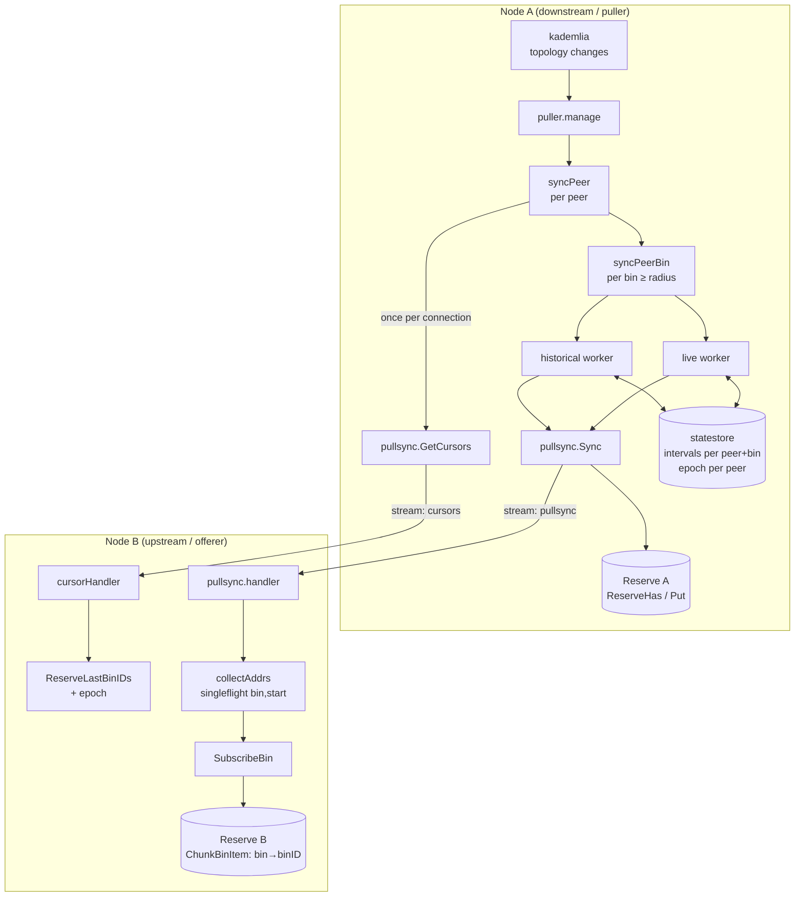

### 2.2 Flow A — peer connect, cursors and epoch

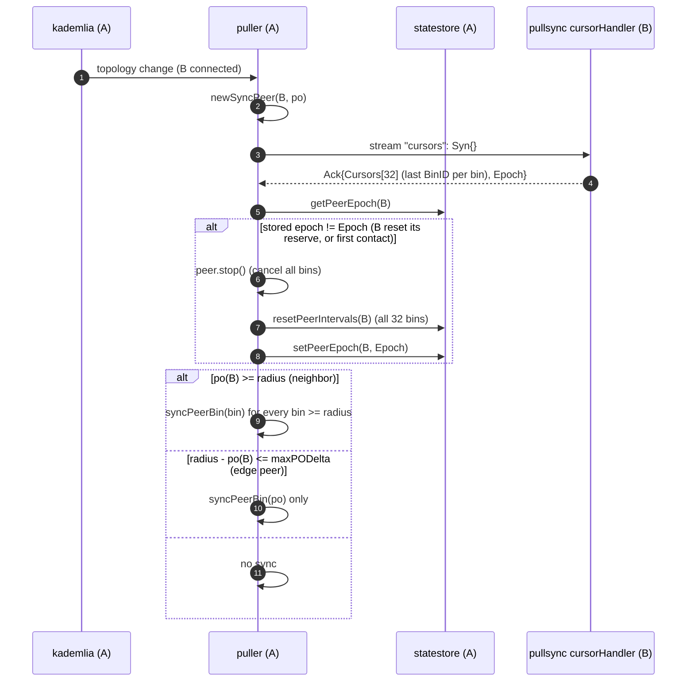

### 2.3 Flow B — one `Sync` call (one page of one bin)

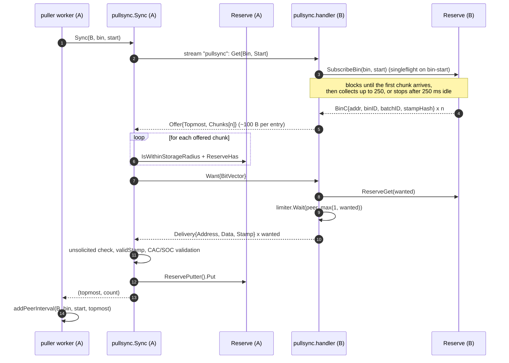

### 2.4 Flow C — historical and live workers per (peer, bin)

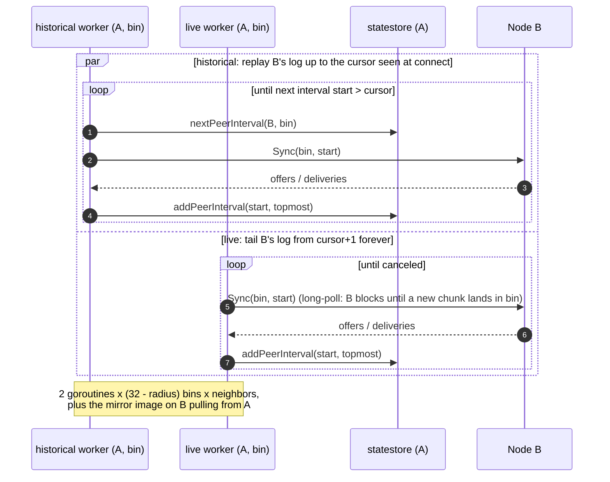

### 2.5 Flow D — radius decrease

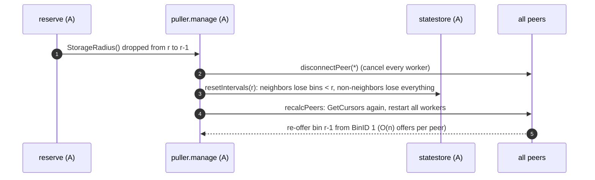

### 2.6 Problems

| # | Problem | Where | Consequence |
|---|---|---|---|
| P1 | The sync key (BinID) is local to each node | `reserve.IncBinID`, `pullsync.collectAddrs` | A peer's whole log must be replayed to learn its set: **O(n) per peer pair**, even when the sets are identical |
| P2 | Per-peer state that gets invalidated | `puller.resetPeerIntervals`, `resetIntervals`, epochs | Peer reserve reset or radius decrease forces a full replay. At 2²² chunks that is ~420 MB of offers **per neighbor** before any chunk moves (~3.4 GB with 8 neighbors) |
| P3 | Live sync offers every chunk from every neighbor | live worker + `SubscribeBin` | Each node receives *k* offers per new chunk, although pushsync already placed it on ~3 nodes (`maxMultiplexForwards = 2`) |
| P4 | Parallel sessions race | `ReserveHas` checked at offer time (`pullsync.go:291`) | The same chunk can be wanted and delivered by several peers at once (SREP's "redundant transmissions") |
| P5 | One direction only | `Sync` is a pull | Two sessions per pair. A stale-stamp divergence (`ErrOverwriteNewerChunk`) is never repaired, because the newer stamp is never sent back |
| P6 | Goroutine and stream fan-out | `syncPeerBin` | ~2 × (32 − r) × k long-lived workers and streams per node |

---

## 3. Goals and non-goals

**Goals**

1. Make sync cost proportional to the **difference** between two reserves (≈ O(n_Δ · log n)), not to their size.
2. Remove per-peer sync state, so restarts, reconnects and peer reserve resets cost nothing when sets match.
3. Transfer each missing chunk **once** per node, even when it is available from many neighbors.
4. Converge a neighborhood in **one round** in steady state (SREP: a neighborhood is a clique, diameter 1).
5. Resist fingerprint-collision attacks from uploaders (active adversaries).
6. Ship side by side with `pullsync/1.4.0` and fall back per peer.

**Non-goals**

- Changing pushsync, retrieval or the reserve's storage, eviction and stamp logic.
- Changing the redistribution game. The audit in §7.9 only *reads* round parameters.
- Sub-second live propagation. That remains pushsync's job (SREP's "out-of-band" principle).

---

## 4. Design overview

### 4.1 Core concepts

| Concept | Definition |
|---|---|
| **Element** | `id = addr (32 B) ‖ stampHash (32 B)`. `stampHash` = keccak256 of the marshaled stamp, which already includes the batch ID, so `id` is unique per (chunk, stamp) pair. The batch ID is stored as the index *value*. |
| **Order** | Lexicographic on `id`. It is the same on every node and prefix-aligned with Kademlia bins and neighborhoods. |
| **Range** | An address prefix `(prefix, bits)`: every element whose address starts with those `bits` bits. All ranges on the wire are prefixes, so Meyer's arbitrary `[x, y)` bounds are not needed. |
| **Root range** | `(base, StorageRadius)`: the node's neighborhood. |
| **Session root** | For peers A and B, the narrower of the two root ranges if one contains the other. If the ranges are disjoint, A and B do not sync (§7.6). |
| **Leaf (bucket)** | A range at depth `StorageRadius + LeafBits` (`LeafBits = 12` → 4096 buckets of ~1k chunks at 2²²). This is the smallest unit with cached summaries. |
| **Fingerprint** | LtHash16 (1024 × 16-bit lanes, lane-wise addition) of `SHAKE128("rangesync/v1" ‖ id)`. It is a group, so elements can be removed and range sums are Fenwick differences. On the wire it is sent as `Digest = keccak256(lthash)` (32 B). |
| **Sketch** | IBLT with `SketchCells = 32` cells. Each cell is `{count int32, keySum [64]B, hashSum uint64}` (~76 B). It is linear, so sketches of disjoint ranges combine by cell-wise addition. |

### 4.2 Architecture

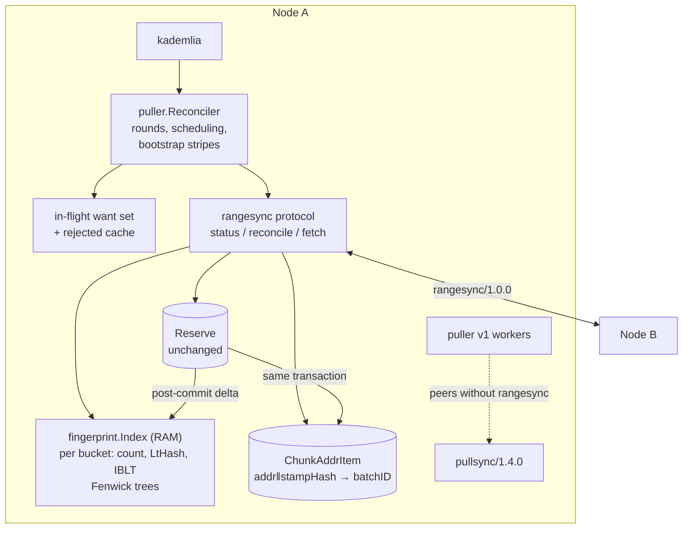

---

### 4.3 How the fingerprint blocks are built

This section walks through the data path from a chunk in the reserve to the 32-byte digest and the sketch that go on the wire.

#### 4.3.1 From chunk to element

Each (chunk, stamp) pair in the reserve becomes one **element**. Three values are derived from its `id`: the bucket it belongs to, its LtHash vector, and its IBLT cell positions.

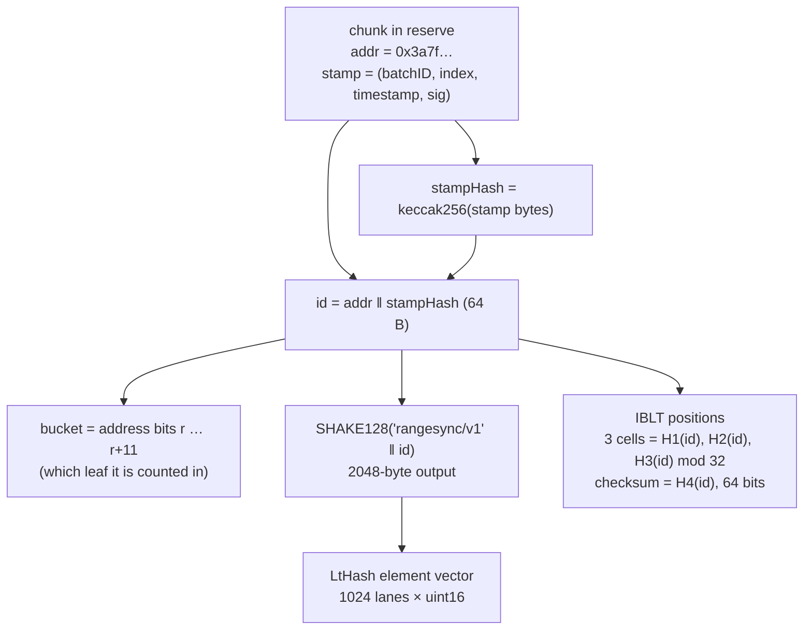

#### 4.3.2 Partitioning the address space

Ranges are address prefixes. The neighborhood prefix (the first `r` bits, where `r` is the storage radius) is shared by every neighbor. The next 12 bits split the neighborhood into a 16-way tree of depth 3, whose leaves are the buckets.

| Address bits | `0 … r−1` | `r … r+3` | `r+4 … r+7` | `r+8 … r+11` | remaining bits |
|---|---|---|---|---|---|
| Meaning | neighborhood prefix (root range) | level-1 range (16) | level-2 range (256) | bucket (4096) | order inside a bucket |
| Chunks per range (2²² reserve) | ~4.2M | ~262k | ~16k | ~1k | — |

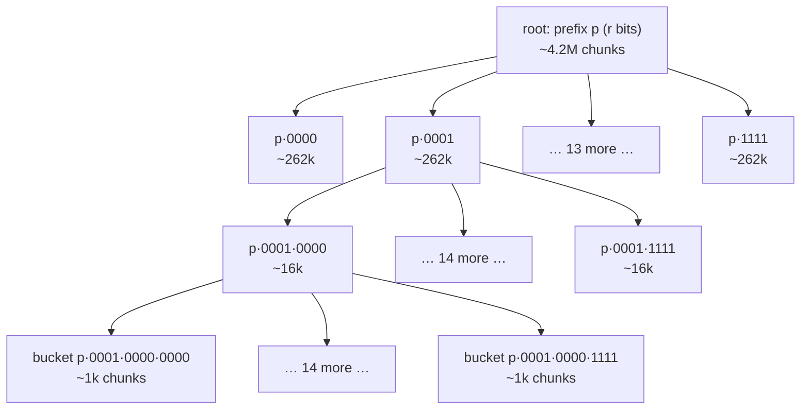

Only the buckets are stored. Level-1 and level-2 summaries, and the root, are computed on demand from the buckets (§4.3.4).

#### 4.3.3 What a bucket holds

Each bucket keeps three summaries of the elements in it. All three are **groups**: an element can be added and removed in any order, and the result depends only on which elements are present.

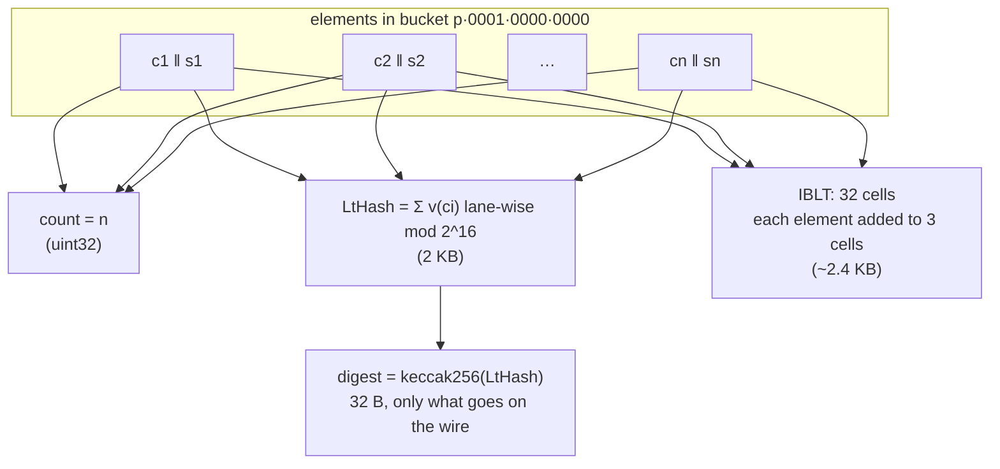

A toy LtHash with 4 lanes instead of 1024 shows why insertion order doesn't matter and why removal is exact:

| | lane 0 | lane 1 | lane 2 | lane 3 |
|---|---|---|---|---|
| v(c1) | `0x1A2B` | `0x0003` | `0xFF10` | `0x7000` |
| v(c2) | `0x0101` | `0xF000` | `0x00F5` | `0x9000` |
| bucket = v(c1) + v(c2) mod 2¹⁶ | `0x1B2C` | `0xF003` | `0x0005` | `0x0000` |
| evict c2: bucket − v(c2) | `0x1A2B` | `0x0003` | `0xFF10` | `0x7000` |

Each IBLT cell holds `{count, keySum, checkSum}`. Inserting an element adds 1 to `count` and XORs the `id` and its checksum into the three cells it maps to. Removing it does the same with −1:

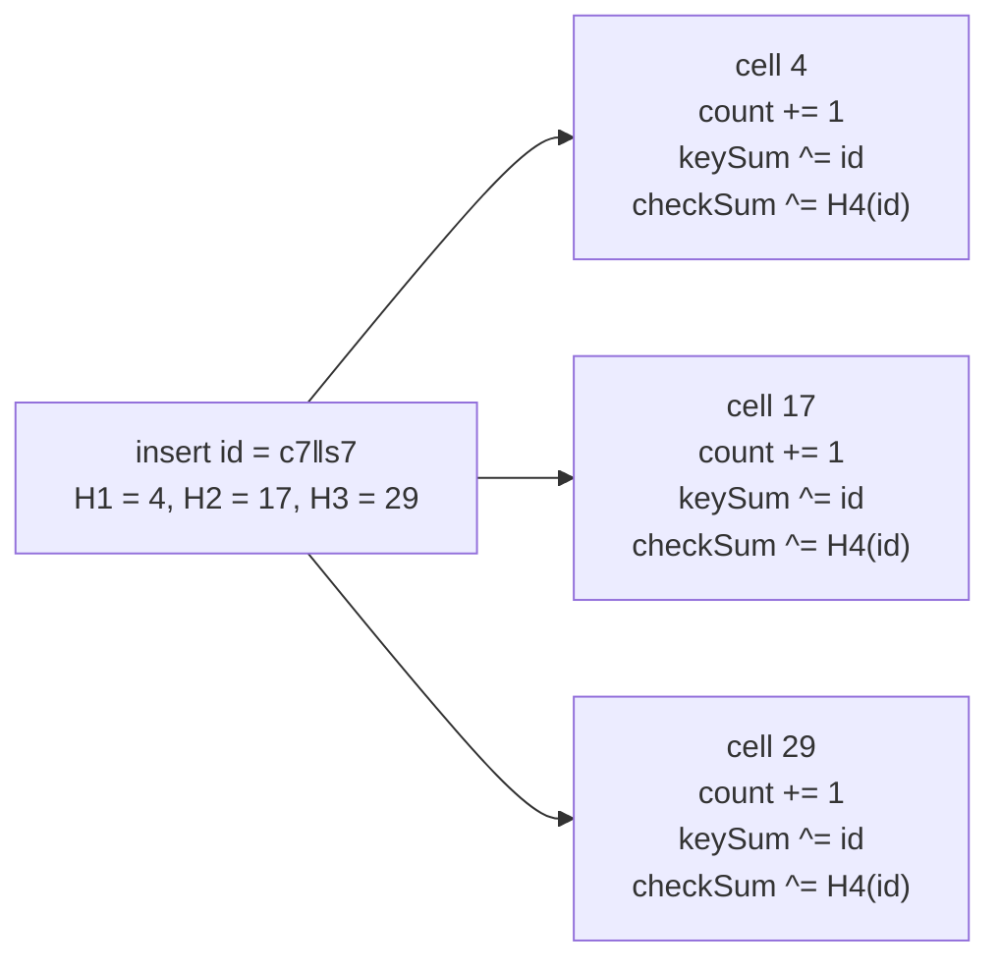

#### 4.3.4 Answering a range query

A range at level 0–3 maps to a contiguous run of buckets. The index keeps a **Fenwick tree** over the buckets, so any run is the difference of two prefix sums, each built from O(log B) stored nodes. The figure shows 8 buckets (1-indexed). Each Fenwick node `Fi` stores the sum of the buckets in brackets.

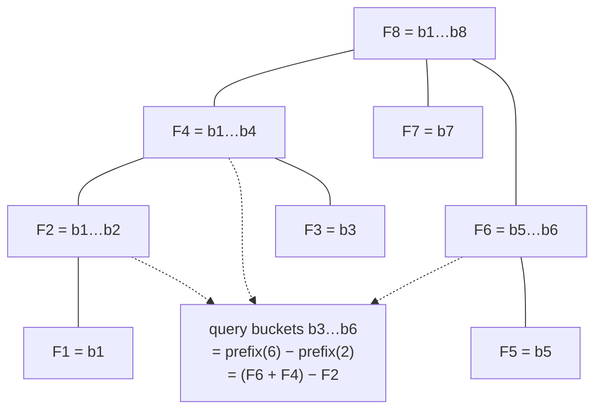

The same query runs on all three summaries (count, LtHash, IBLT), because each supports subtraction. For B = 4096 a query touches at most 24 stored nodes. That's 24 vector operations over 1024 lanes, a few microseconds.

#### 4.3.5 Keeping the index current

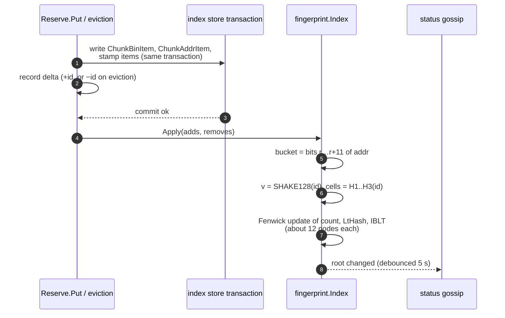

#### 4.3.6 Decoding a sketch difference

When peers exchange sketches for the same range, the receiver subtracts the remote sketch from its own. Elements both sides hold cancel out. What remains encodes only the difference. Cells with `count = +1` hold an element only the local side has, cells with `count = −1` hold an element only the remote side has. The receiver "peels" those pure cells one at a time:

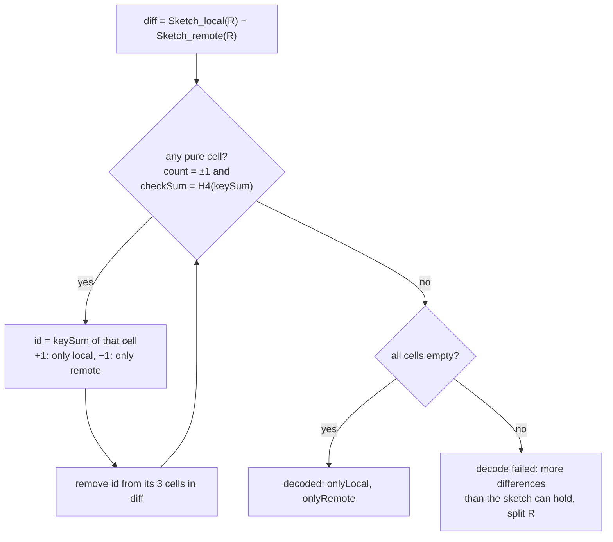

With 32 cells and 3 cells per element, decoding succeeds with high probability for up to about 20 differences in a range.

---

## 5. Storage layer

### 5.1 New index: `ChunkAddrItem`

```go
// pkg/storer/internal/reserve/items.go

// ChunkAddrItem orders reserve chunks by address for range reconciliation.
type ChunkAddrItem struct {
	Address   swarm.Address
	StampHash []byte
	BatchID   []byte
	ChunkType swarm.ChunkType
}

func (c *ChunkAddrItem) Namespace() string { return "chunkAddr" }

// addr/stampHash
func (c *ChunkAddrItem) ID() string { return c.Address.ByteString() + string(c.StampHash) }

// Marshal encodes BatchID (32 B) + ChunkType (1 B) as the value.
```

The item is written and deleted in the **same transaction** as `ChunkBinItem`:

| Path | File | Change |
|---|---|---|
| `Reserve.Put`: new chunk | `reserve.go` | Put `ChunkAddrItem`, record delta `+id` |
| `Reserve.Put`: same address, newer stamp | `reserve.go` | Delete old, put new, record deltas `−old +new` |
| `Reserve.Put`: different address, same stamp index | `reserve.go` → `removeChunk` | Covered by `RemoveChunkWithItem` |
| `RemoveChunkWithItem`, `RemoveChunkMetaData` (eviction) | `reserve.go` | Delete `ChunkAddrItem`, record delta `−id` |
| `DeleteCorruptedChunkMetadata` | `reserve.go` | Delete `ChunkAddrItem`, record delta `−id` |
| `Reset` | `reserve.go` | Drop the namespace, reset the in-memory index |

Disk cost: ~4.2M × ~80 B ≈ **350 MB** at full capacity. One extra key on top of the ~5 that `Put` already writes.

Migration: a new step in `pkg/storer/migration` fills `ChunkAddrItem` by iterating `ChunkBinItem`.

### 5.2 In-memory fingerprint index

```go
// pkg/storer/internal/reserve/fingerprint (new package)

type ID [64]byte // addr ‖ stampHash

type LtHash [1024]uint16
func (h *LtHash) Add(id ID)
func (h *LtHash) Sub(id ID)
func (h *LtHash) AddHash(o *LtHash)
func (h *LtHash) SubHash(o *LtHash)
func (h *LtHash) Digest() [32]byte

type Sketch [SketchCells]Cell
func (s *Sketch) Insert(id ID)
func (s *Sketch) Remove(id ID)
func (s *Sketch) Subtract(o *Sketch)
func (s *Sketch) Decode() (onlyLocal, onlyRemote []ID, ok bool)

type Range struct {
	Prefix swarm.Address
	Bits   uint8
}

type Summary struct {
	Count  uint64
	Digest [32]byte
}

// Index caches per-bucket summaries under a root range.
type Index struct {
	mu       sync.RWMutex
	root     Range
	leafBits uint8
	counts   fenwick[uint32]
	hashes   fenwick[LtHash]
	sketches fenwick[Sketch]
}

func (ix *Index) Apply(adds, removes []ID)
func (ix *Index) Summary(r Range) (Summary, error) // r.Bits <= root.Bits+leafBits
func (ix *Index) Sketch(r Range) (*Sketch, error)
func (ix *Index) Rebuild(root Range, iterate func(func(ID) error) error) error
```

- **Fenwick trees** over a flat bucket slab. A range at or above leaf depth maps to a contiguous run of buckets, so its value is `prefix(j) − prefix(i)` in O(log B) vector operations. This only works because the fingerprints are groups (they have subtraction).
- **Below leaf depth** (needed only when a peer's leaves are deeper): scan `ChunkAddrItem` for that prefix. The scan is at most one bucket of ~1k items.
- **Updates.** Deltas are collected inside the `r.st.Run` closure and applied with `Index.Apply` after the transaction returns `nil`. `EvictBatchBin` applies them per committed batch.
- **Rebuild** happens at startup and when `StorageRadius` changes (the root and the bucket grid move):
  1. Take `ix.mu.Lock()`, open a LevelDB iterator over `chunkAddr` (goleveldb iterators read from an implicit snapshot), then release the lock.
  2. Build the new slab from the iterator.
  3. Commits that land after the iterator was opened apply their deltas to both the old and the new slab.
  4. Writers hold `ix.mu.RLock()` across commit and apply, so every commit is either in the snapshot or in the delta stream, never both.
  5. Swap the slabs. `rangesync` answers `Busy` for ranges not yet covered while a rebuild runs.
- **Change notification:** a `SubscribeRootChange()` channel, debounced, drives status gossip.

### 5.3 Memory budget (B = 4096 buckets, reserve full)

| Component | Size |
|---|---|
| Counts (Fenwick) | 16 KB |
| LtHash16 (Fenwick) | 8 MB |
| IBLT, 32 cells × 76 B (Fenwick) | 10 MB |
| Session buffers (≤ 1024 parts, ≤ 16 sessions) | ≤ 2 MB |
| In-flight want set (≤ 10k IDs) | ≈ 1.2 MB |
| **Total** | **≈ 18 MB steady, ≈ 21 MB peak** |

Using ECMH instead of LtHash reduces the total to about 10 MB at a higher CPU cost per update. The choice is benchmarked in Phase 1.

### 5.4 Storer API

```go
// pkg/storer/storer.go

type ReserveRangeStore interface {
	ReserveRoot() fingerprint.Range
	ReserveRangeSummary(r fingerprint.Range) (fingerprint.Summary, error)
	ReserveRangeSketch(r fingerprint.Range) (*fingerprint.Sketch, error)
	ReserveIterateRange(r fingerprint.Range, after fingerprint.ID, cb func(ChunkID) (stop bool, err error)) error
	ReserveGetByID(ctx context.Context, addr swarm.Address, stampHash []byte) (swarm.Chunk, error)
	SubscribeRootChange() (<-chan struct{}, func())
}

type ChunkID struct {
	Address   swarm.Address
	StampHash []byte
	BatchID   []byte
}
```

`ReserveGetByID` resolves `BatchID` from `ChunkAddrItem` and calls the existing `ReserveGet`.

---

## 6. Wire protocol: `rangesync/1.0.0`

### 6.1 Streams

| Stream | Direction | Purpose |
|---|---|---|
| `status` | either side → peer | Gossip the root summary when it changes (debounced to `StatusMinInterval = 5s`) and as a heartbeat (`StatusMaxInterval = 60s`) |
| `reconcile` | initiator → responder | One reconciliation session. Messages alternate until one side sends an empty message |
| `fetch` | requester → holder | `Want` a list of IDs, receive `Delivery` messages. Used by both sides of a session |

### 6.2 Messages

```proto
syntax = "proto3";

package rangesync;

option go_package = "pb";

message Range {
  bytes  Prefix = 1; // ceil(Bits/8) bytes
  uint32 Bits = 2;
}

message Status {
  Range  Root = 1;      // sender's neighborhood: (overlay prefix, StorageRadius)
  uint64 Count = 2;
  bytes  Digest = 3;    // 32 B
  uint32 LeafBits = 4;  // sender's bucket depth below Root
  uint64 AuditRound = 5;
  bytes  AuditDigest = 6; // §7.9, empty when not yet computed
}

message Fingerprint {
  Range  Range = 1;
  uint64 Count = 2;
  bytes  Digest = 3;    // omitted when Count == 0
}

message Sketch {
  Range  Range = 1;
  uint64 Count = 2;
  bytes  Cells = 3;     // SketchCells x CellSize
}

message ID {
  bytes Address = 1;
  bytes StampHash = 2;
}

message Items {
  Range       Range = 1;
  repeated ID IDs = 2;
  bytes       After = 3;   // paging cursor (last ID of the previous page)
  bool        More = 4;    // more pages follow on this stream
  bool        Reply = 5;   // Meyer's flag: receiver must answer with its own items in Range
}

message Part {
  oneof Kind {
    Fingerprint FP = 1;
    Sketch      Sketch = 2;
    Items       Items = 3;
  }
}

message Message {
  repeated Part Parts = 1;  // <= MaxParts (1024)
  bool          Busy = 2;   // responder is rebuilding or over its session cap
}

// fetch stream
message Want {
  repeated ID IDs = 1;      // <= 250
}

message Delivery {
  bytes Address = 1;
  bytes Data = 2;
  bytes Stamp = 3;
}
```

Approximate wire sizes: `Fingerprint` ≈ 55 B, `Sketch` ≈ 2.4 KB, `ID` ≈ 70 B.

### 6.3 Per-range decision rule

Both sides apply the same rule to every incoming `Fingerprint` part. It is a pure function in `pkg/rangesync/session.go`, so it can be unit-tested and fuzzed on its own.

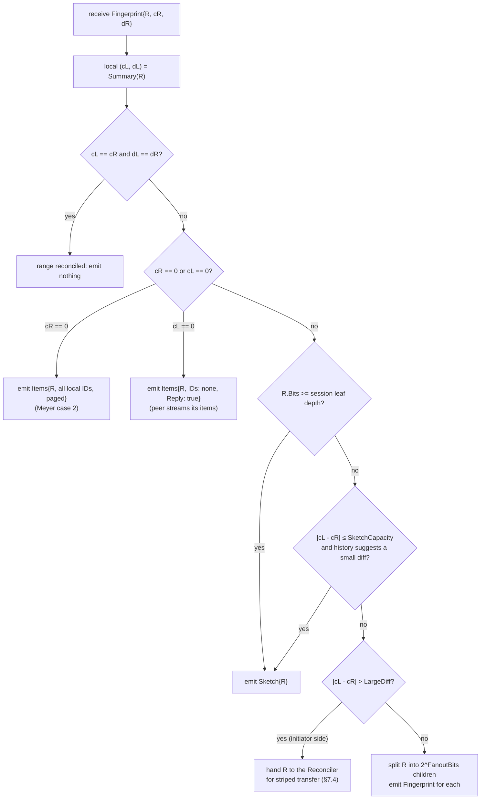

Receiving the other part types:

| Incoming part | Action |
|---|---|
| `Sketch{R}` | Subtract the local `Sketch(R)` and decode. **On success:** queue `onlyRemote` for fetch and emit `Items{R, onlyLocal, Reply: false}` so the peer can fetch them. **On failure:** split R and emit child `Fingerprint`s. |
| `Items{R, IDs, Reply}` | Queue the IDs the node doesn't hold for fetch. If `Reply`, emit `Items{R, local IDs not in IDs, Reply: false}`. Paging continues while `More`. |

Session leaf depth = `min(Root.Bits + LeafBits)` over both peers (exchanged in `Status`), so neither side has to scan below its own buckets.

Constants: `FanoutBits = 4` (16 children), `SketchCells = 32` (capacity ≈ 20 differences), `MaxParts = 1024`, `ItemsPageSize = 1024`, `LargeDiff = 65536`.

### 6.4 Validation and limits

- Every incoming `Range` must lie inside the session root and be at most leaf depth (or at most 4 bits deeper, to allow a peer with deeper leaves). Otherwise the stream is reset and the peer is penalized.
- A `Fingerprint` child set must partition a range the receiver sent in the previous message. This blocks requests for arbitrary ranges that would amplify CPU work.
- `MaxParts` per message, `MaxConcurrentSessions = 16` per node and 1 per peer. Sessions over the cap get `Busy`.
- Delivery validation is unchanged from `pullsync.Sync`: unsolicited check, `validStamp`, CAC/SOC checks, `ReservePutter().Put`, plus the existing per-peer delivery rate limiter.

---

## 7. Sync flows (new design)

### 7.1 Steady state: synced neighbors

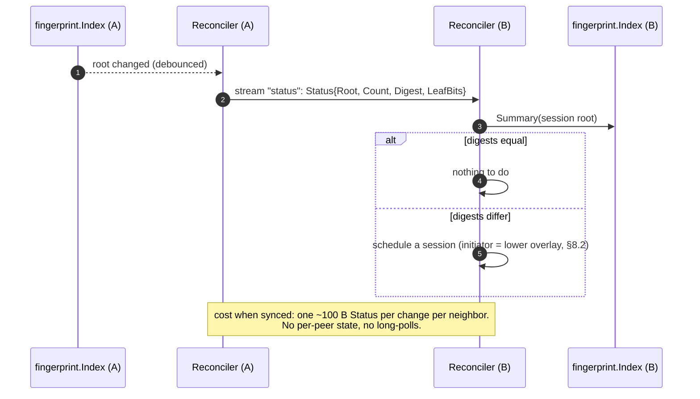

### 7.2 Small difference: one sketch round trip, two-way fetch

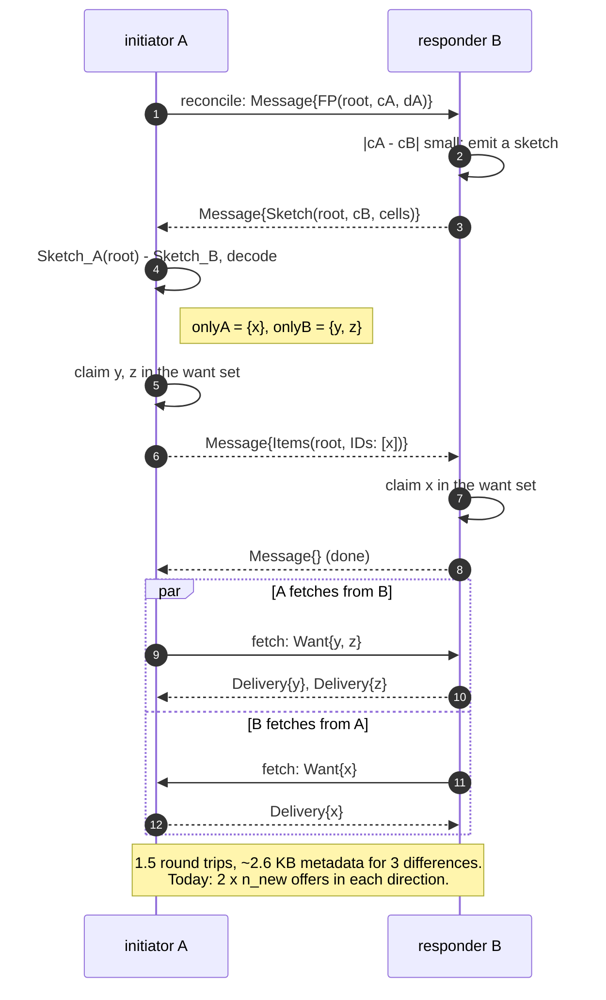

### 7.3 Medium difference: range descent ending in sketches

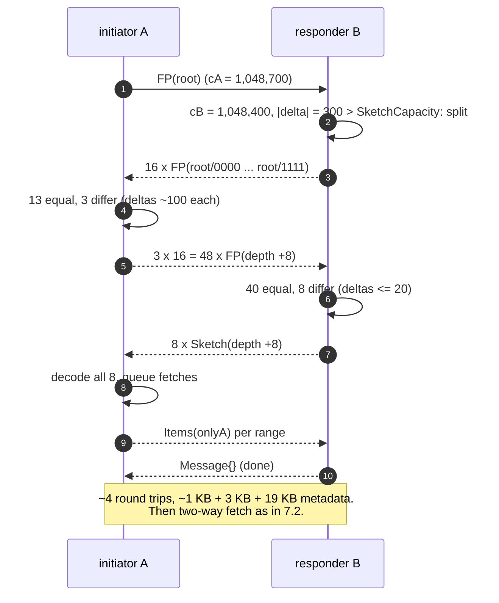

### 7.4 Bootstrap or large difference: striped transfer and verification

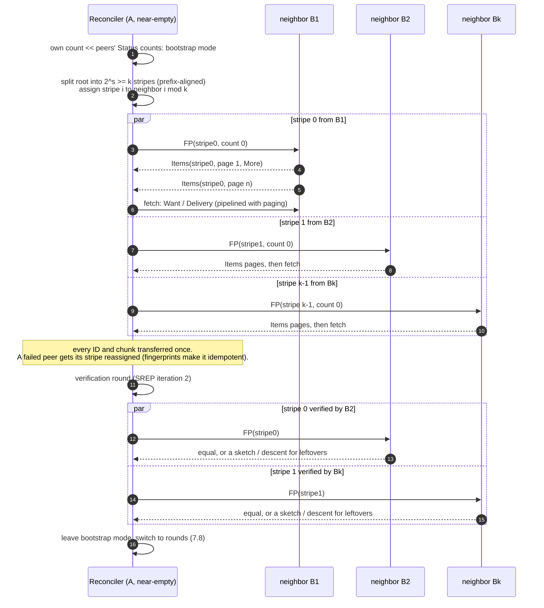

Compared with today, with 2²² chunks and 8 neighbors:

| | Today | `rangesync` |
|---|---|---|
| ID metadata received | ~3.4 GB (every neighbor offers everything) | ~270 MB (each ID once) + a few KB verification |
| Chunk data | ≥ 17 GB, with racing duplicates | 17 GB, each chunk once |
| Per-peer state written | 32 intervals + epoch per neighbor | none |

### 7.5 Radius decrease

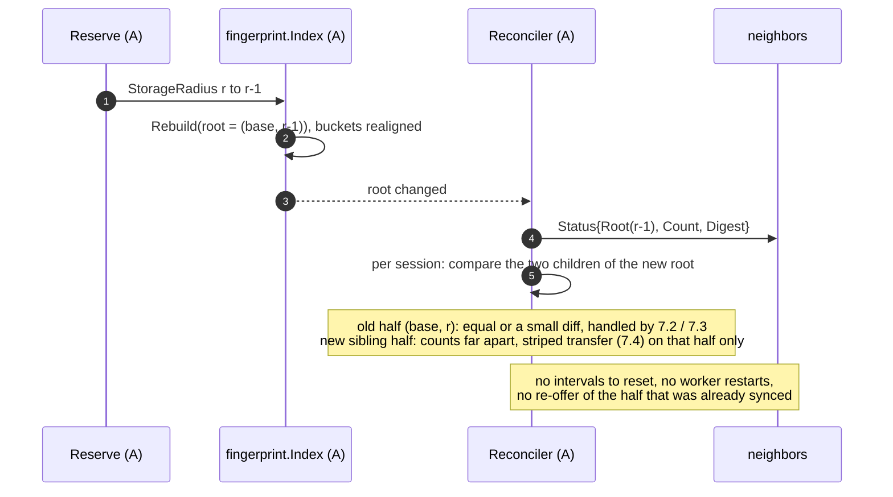

Radius increase only narrows the root. Evicted chunks leave the fingerprints through the normal eviction deltas, and nothing is transferred.

### 7.6 Edge peers (nested neighborhoods)

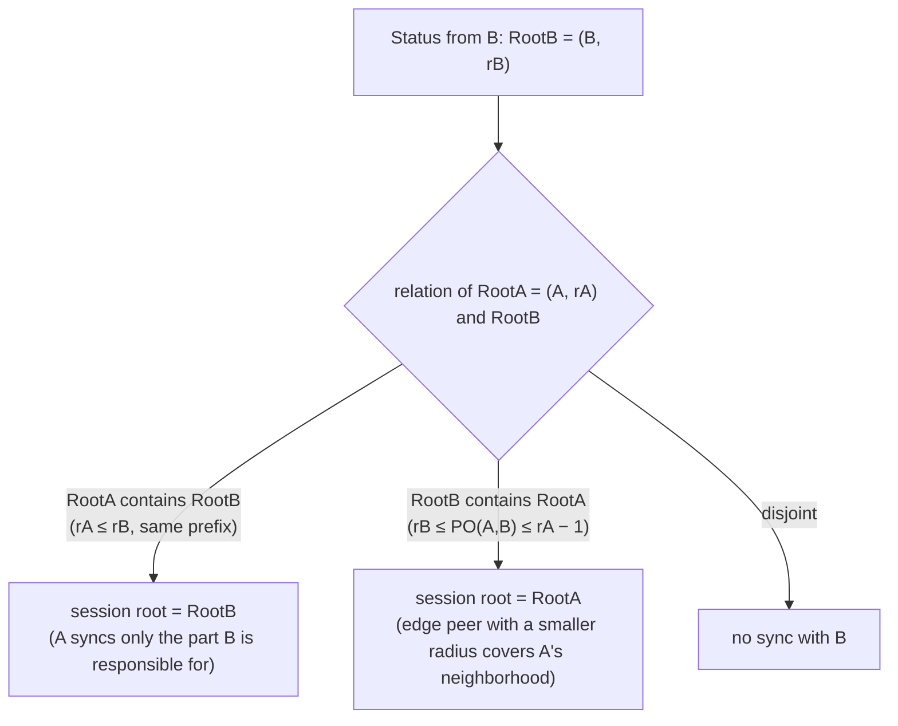

This replaces the `maxPODelta` special case and the "sync only the PO bin" logic (`puller.go:315`). Eligibility follows directly from whether the two neighborhoods overlap.

### 7.7 Stale-stamp divergence (two-way exchange)

```mermaid
sequenceDiagram
    autonumber
    participant A as Node A (stamp s1 for chunk c)
    participant B as Node B (newer stamp s2 for chunk c)
    A->>B: FP(R)
    B-->>A: Sketch(R)
    A->>A: decode: onlyA = {c‖s1}, onlyB = {c‖s2}
    A-->>B: Items(R, [c‖s1])
    par
        A->>B: Want{c‖s2}
        B-->>A: Delivery(c, s2)
        A->>A: Put replaces s1 with s2 (newer timestamp), index -s1 +s2
    and
        B->>A: Want{c‖s1}
        A-->>B: Delivery(c, s1)
        B->>B: Put returns ErrOverwriteNewerChunk, add c‖s1 to the rejected cache (TTL)
    end
    Note over A,B: next round: digests equal. Today A never learns about s2.
```

### 7.8 Rounds across all neighbors with de-duplication (SREP)

```mermaid
sequenceDiagram
    autonumber
    participant A as Reconciler (A)
    participant W as want set (A)
    participant B1 as neighbor B1
    participant B2 as neighbor B2
    participant B3 as neighbor B3
    Note over A,B3: round t: every session reads the same index snapshot
    par
        A->>B1: session: decoded onlyB1 = {x, y}
        A->>W: claim(x), claim(y) both granted
        A->>B1: Want{x, y}
    and
        A->>B2: session: decoded onlyB2 = {x, z}
        A->>W: claim(x) denied (held by B1), claim(z) granted
        A->>B2: Want{z}
    and
        A->>B3: session: digests equal
    end
    alt B1 fails to deliver x before the claim deadline
        W-->>A: release(x)
        A->>B2: Want{x} (retry from a peer that has it)
    end
    Note over A,B3: neighborhood is a clique, so I = 1 round (SREP Lemma 2).<br/>Each missing chunk is fetched once per node (no Theorem 1 redundancy).
```

**Live-traffic cost model** (per new chunk, neighborhood of N nodes, pushsync places it on p ≈ 3 nodes):

| | Today | `rangesync` rounds |
|---|---|---|
| Metadata | every node receives *N − 1* offers × 100 B | only (has, lacks) pairs carry it: p·(N − p) × ~150 B of sketch share |
| N = 9 | ~7.2 KB | ~2.7 KB |
| N = 17 | ~27 KB | ~6.3 KB |
| Fill latency | ~250 ms (long-poll page) | one round (`RoundInterval`, adaptive 5–30 s) |

The ~150 B per difference assumes the sketches are sized well (§6.3 and the history-based estimate). If sizing is poor, the metadata cost can double. The `rangesync_sketch_decode_failures` metric (§10) tracks this.

### 7.9 Salted audit each redistribution round

```mermaid
sequenceDiagram
    autonumber
    participant SI as storageincentives agent (A)
    participant RS as rangesync (A)
    participant N as neighbors
    SI->>RS: round t started, anchor known
    RS->>RS: scan ChunkAddrItem in the committed neighborhood<br/>audit = LtHash(SHAKE128(anchor ‖ id)), IDs only
    RS->>N: Status{..., AuditRound: t, AuditDigest}
    N-->>RS: Status{..., AuditRound: t, AuditDigest}
    alt audit digests differ but plain digests are equal
        RS->>RS: collision suspected: metric + warning,<br/>force a session that uses the anchor salt for every range
    else audit digests differ
        RS->>RS: normal session (difference is real)
    end
    Note over SI,RS: finishes before the commit phase, so a node learns its<br/>reserve commitment would differ while it can still repair it
```

The anchor is unknown in advance, so a colliding set prepared before the round is useless. The scan reads IDs only (no chunk data): about 4M SHAKE expansions, a few seconds, once per round.

---

### 7.10 Worked examples: A and B with mostly identical sets

The three examples below show a single A ↔ B session in detail. Both nodes are neighbors at radius `r` with about 4.2M chunks each, and they agree on all but a handful. A has the lower overlay address, so A initiates. `cap` is the sketch capacity (about 20 differences).

#### Example 1: one chunk missing

Pushsync delivered chunk `x` to A but not to B.

```mermaid
sequenceDiagram
    autonumber
    participant A as Node A (has x)
    participant B as Node B
    A->>B: status: Status{count N+1, digest dA}
    B->>B: local count N, digest dB ≠ dA, so wait for A to start
    A->>B: reconcile: Message{FP(root, N+1, dA)}
    B->>B: |delta| = 1 ≤ cap, so send a sketch
    B-->>A: Message{Sketch(root, N, cells)}
    A->>A: Sketch_A(root) − Sketch_B, peel: onlyA = {x}
    A-->>B: Message{Items(root, [x])}
    B->>B: x unknown, claim it in the want set
    B-->>A: Message{} (done)
    B->>A: fetch: Want{x}
    A-->>B: Delivery{x}
    B->>B: validate stamp, Put, index Apply(+x)
    B->>A: status: Status{count N+1, digest dA}
    Note over A,B: 3 reconcile messages, about 2.5 KB metadata, then 1 chunk
```

#### Example 2: several kinds of difference at once

Differences between A and B:

| Label | Where (level-1 range) | What |
|---|---|---|
| `x` | `p·0011` | 1 chunk only on A |
| `y1, y2` | `p·1010` | 2 chunks only on B |
| `w1 … w40` | `p·0111` | 40 chunks only on B (a burst uploaded while A was restarting) |
| `z` | `p·1100` | same chunk, A holds stamp `s1`, B holds a newer stamp `s2` |

Counts: A = N + 2, B = N + 43, so |delta| = 41. Where the differences sit in the range tree:

```mermaid
flowchart LR
    R["root p<br/>A: N+2, B: N+43<br/>delta 41 > cap: split"]
    R --> E1["12 level-1 ranges<br/>digests equal: done"]
    R --> D3["p·0011<br/>delta 1"]
    R --> D7["p·0111<br/>delta 40 > cap: split"]
    R --> DA["p·1010<br/>delta 2"]
    R --> DC["p·1100<br/>delta 0, digests differ"]
    D3 --> S3["sketch: onlyA = x"]
    DA --> SA["sketch: onlyB = y1, y2"]
    DC --> SC["sketch: onlyA = z‖s1<br/>onlyB = z‖s2"]
    D7 --> E7["13 level-2 ranges equal"]
    D7 --> W1["p·0111·0010<br/>delta 15"]
    D7 --> W2["p·0111·0110<br/>delta 14"]
    D7 --> W3["p·0111·1101<br/>delta 11"]
    W1 --> SW1["sketch: onlyB = 15 w's"]
    W2 --> SW2["sketch: onlyB = 14 w's"]
    W3 --> SW3["sketch: onlyB = 11 w's"]
    classDef diff fill:#fde2e2,stroke:#c0392b
    classDef same fill:#e3f4e1,stroke:#2e7d32
    classDef sk fill:#e3ecfb,stroke:#1f5fbf
    class R,D3,D7,DA,DC,W1,W2,W3 diff
    class E1,E7 same
    class S3,SA,SC,SW1,SW2,SW3 sk
```

The session that resolves it:

```mermaid
sequenceDiagram
    autonumber
    participant A as Node A
    participant B as Node B
    A->>B: Message{FP(root, N+2)}
    B->>B: delta 41 > cap, split into 16 children
    B-->>A: Message{16 × FP(p·0000 … p·1111)}
    A->>A: compare: 12 equal, 4 differ
    Note right of A: p·0011, p·1010, p·1100: delta ≤ cap, send sketches<br/>p·0111: delta 40 > cap, split
    A-->>B: Message{Sketch(p·0011), Sketch(p·1010),<br/>Sketch(p·1100), 16 × FP(p·0111·xxxx)}
    B->>B: decode p·0011: onlyA = {x}
    B->>B: decode p·1010: onlyB = {y1, y2}
    B->>B: decode p·1100: onlyA = {z‖s1}, onlyB = {z‖s2}
    B->>B: p·0111 children: 13 equal, 3 differ (15, 14, 11 ≤ cap)
    B-->>A: Message{Items(p·1010, [y1, y2]), Items(p·1100, [z‖s2]),<br/>3 × Sketch(p·0111·…)}
    A->>A: decode 3 sketches: onlyB = {w1 … w40}
    A-->>B: Message{} (done)
    par A fetches from B
        A->>B: fetch: Want{y1, y2, z‖s2, w1 … w40}
        B-->>A: 43 × Delivery
        A->>A: Put z‖s2 replaces z‖s1 (newer timestamp)
    and B fetches from A
        B->>A: fetch: Want{x, z‖s1}
        A-->>B: 2 × Delivery
        B->>B: Put z‖s1 returns ErrOverwriteNewerChunk,<br/>add to rejected cache
    end
    A->>B: status: digest equal on both sides
    Note over A,B: 5 reconcile messages, about 17 KB metadata<br/>(55 B + 0.9 KB + 8.1 KB + 7.5 KB + 0),<br/>then 45 chunks. The stale stamp z is repaired.
```

#### Example 3: equal counts hide a larger difference

Counts only give a lower bound on the difference. Here range `p·0101` has 12 chunks only on A and 13 only on B, so |delta| = 1 although 25 elements differ. That's more than one sketch can decode.

```mermaid
sequenceDiagram
    autonumber
    participant A as Node A
    participant B as Node B
    Note over A,B: earlier steps as in example 2 lead to range p·0101
    A->>B: Message{FP(p·0101, c+12)}
    B->>B: delta 1 ≤ cap, try a sketch
    B-->>A: Message{Sketch(p·0101)}
    A->>A: peel: no pure cells left, cells not empty, decode failed
    A-->>B: Message{16 × FP(p·0101·xxxx)}
    B->>B: 25 differences spread over 9 children, each ≤ cap
    B-->>A: Message{9 × Sketch(p·0101·…)}
    A->>A: all 9 decode: onlyA = 12 IDs, onlyB = 13 IDs
    A-->>B: Message{Items(…, 12 onlyA IDs)}
    B-->>A: Message{} (done)
    Note over A,B: a failed decode costs one extra round trip and one wasted sketch (~2.4 KB),<br/>never correctness. The session history marks this range so the next round splits first.
```

---

## 8. Orchestration: `puller.Reconciler`

### 8.1 Per-peer state machine

```mermaid
stateDiagram-v2
    [*] --> Probing: peer connected
    Probing --> V1Fallback: rangesync stream not supported
    Probing --> Idle: Status exchanged, root relation known
    Idle --> Idle: Status with equal digest
    Idle --> Reconciling: digest differs (initiator) or timer
    Reconciling --> Fetching: session done, wants queued
    Reconciling --> Striped: large difference
    Striped --> Fetching: stripe done
    Fetching --> Idle: wants delivered or released
    Reconciling --> Idle: Busy / error (backoff)
    Idle --> [*]: disconnected or neighborhoods disjoint
    V1Fallback --> [*]: disconnected
```

### 8.2 Scheduling rules

- **Initiator.** When both sides see a mismatch, the peer with the lower overlay address starts the session. The other side waits `2 × RoundInterval + jitter` and starts it itself if the mismatch persists. This covers an unresponsive initiator.
- **Rounds.** At most one session per peer at a time. All sessions in a round read the same index snapshot (the index is under `RLock`, and deltas applied during the round reach the next round). `RoundInterval` shrinks toward 5 s while differences are found and grows toward 30 s while every digest matches.
- **Want set** (`pkg/puller/inflight.go`): `claim(id, peer, deadline)`, `release(id)`, `done(id)`. Claims expire after 30 s and the ID can then be claimed through another peer.
- **Rejected cache.** IDs that fail `validStamp` or return `ErrOverwriteNewerChunk` are skipped for `RejectTTL = 10 min`. This stops refetch loops caused by expired-batch skew and stale stamps.
- **Rate limits.** The existing global puller limiter (1000 chunks/s) and the per-peer delivery limiter on the responder are reused unchanged.

### 8.3 Coexistence with `pullsync/1.4.0`

The node registers both protocols. For each peer the `Reconciler` first tries `rangesync`. If the stream is not supported, it hands the peer to the current `syncPeer` / `syncPeerBin` path. The v1 handler keeps serving v1 peers. BinIDs, `SubscribeBin` and the interval store stay until v1 is removed.

---

## 9. Security

| Threat | New in this design? | Mitigation |
|---|---|---|
| Crafted fingerprint collision: an uploader makes two honest nodes hold different sets with equal digests (silent divergence) | **Yes** | LtHash or ECMH, never XOR or plain sum. The salted per-round audit (§7.9) defeats collisions prepared in advance. Other honest neighbors that hold the item break the collision. |
| CPU amplification through arbitrary ranges | Yes | Only prefix ranges are allowed, children must partition ranges the receiver sent, `MaxParts`, session caps |
| Bucket skew: addresses mined into one prefix | Yes | Every chunk needs a stamp slot (costly). The sub-leaf scan is bounded per message. Adaptive leaf splitting is a future option. |
| Stripe withholding by a malicious neighbor | Yes (weaker redundancy) | Verification round with a different peer, stripe timeout and reassignment. Optionally assign each stripe to 2 peers. |
| Claim and stall (wins the want-set claim, never delivers) | Yes | Claim deadline, then reassignment and a per-peer failure score |
| Status spam causing sessions | Partly | Per-peer session rate limit, at most 1 session per peer |
| Poisoned IBLT (decodes to bogus IDs) | Same as offering nonexistent chunks today | Decode iteration cap. Bogus wants return nothing and count against the peer. |
| Peer claims a forced full listing (count 0) | Same as paging from BinID 0 today | Paged responses + per-peer rate limit |
| Peer lies about its epoch to force a full replay | **Removed** | No epochs |

---

## 10. Metrics

New metrics in the `rangesync` namespace:

- `sessions_total{result}` and `session_rounds` (histogram)
- `parts_sent{type}` and `parts_received{type}`
- `bytes_metadata{dir}` and `bytes_chunks{dir}`
- `pairwise_diff` (histogram of n_Δ per session). This is SREP's 𝒫 distribution and is used to tune `SketchCells`, `FanoutBits` and `RoundInterval`.
- `sketch_decode_failures`
- `want_claims{result}` and `rejected_cache_size`
- `audit_mismatch{kind}`
- `index_rebuild_seconds`, `index_apply_seconds`, `index_memory_bytes`

---

## 11. Code layout

| Package / file | Status | Content |
|---|---|---|
| `pkg/storer/internal/reserve/fingerprint/` | new | `lthash.go`, `sketch.go`, `fenwick.go`, `index.go` |
| `pkg/storer/internal/reserve/items.go` | changed | `ChunkAddrItem` |
| `pkg/storer/internal/reserve/reserve.go` | changed | Writes and deletes `ChunkAddrItem`, collects deltas, `Index.Apply` after commit |
| `pkg/storer/internal/reserve/range.go` | new | Range iteration, `GetByID` |
| `pkg/storer/reserve.go`, `storer.go` | changed | `ReserveRangeStore`, rebuild on radius change |
| `pkg/storer/migration/step_0x_chunkaddr.go` | new | Fills `ChunkAddrItem` |
| `pkg/rangesync/` | new | `rangesync.go` (spec, handlers), `session.go` (pure decision logic), `fetch.go`, `status.go`, `pb/` |
| `pkg/puller/reconciler.go`, `inflight.go` | new | Rounds, striping, want set, rejected cache |
| `pkg/puller/puller.go` | changed | Per-peer dispatch to the reconciler or the v1 workers |
| `pkg/storageincentives/agent.go` | changed (Phase 5) | Triggers the salted audit |
| `pkg/node/node.go`, `cmd/bee/cmd/cmd.go` | changed | Wiring, `--rangesync-enable` flag |

---

## 12. Rollout

| Phase | Ships | Removes or improves | Depends on |
|---|---|---|---|
| 0 | Node-wide want set in the current `pullsync.Sync`. Salted audit as a metric only. | Duplicate deliveries (P4) | nothing |
| 1 | `ChunkAddrItem` + migration, `fingerprint.Index`, `rangesync` with fingerprints and item lists (no sketches), behind a flag. LtHash vs ECMH benchmark. | Nothing removed; runs alongside v1 | — |
| 2 | Striped bootstrap and radius-decrease handling (§7.4, §7.5) | Historical workers, `resetIntervals`, epochs (for v2 peers) | 1 |
| 3 | Rounds, status gossip, `Reconciler` (§7.1, §7.8) | Live workers (for v2 peers) | 1 |
| 4 | Sketch tier (§7.2, §7.3) | Fewer round trips and bytes | 1 |
| 5 | Audit wired into storageincentives (§7.9) | — | 1 |
| 6 | Default on. Deprecate, then remove `pullsync/1.4.0`, BinIDs and the interval store. | P1, P2, P5, P6 | 2, 3 |

---

## 13. Testing

- **Fingerprint primitives.** Group laws (associativity, inverse, `Add` then `Sub` gives the identity), Fenwick range sums against brute force, IBLT decode success rate against the size of the difference. All fuzzed.
- **Index consistency.** A fuzz test with random sequences of `Put`, replace and evict checks that `Rebuild()` equals the live index after every step, including rebuilds that run during concurrent writes. This catches missed delete paths, which would otherwise cause phantom differences forever.
- **Protocol.** Two reserves in memory with random overlapping sets, connected through `pkg/p2p/streamtest`. Both must end with the union for differences of 0, 1, 20, 1k and 100% (empty side). Assert round counts and byte counts against the bounds in §7.
- **Adversarial.** Malformed or oversized messages, ranges outside the root, children that don't partition their parent, never-ending `More` paging, bogus sketches. Extend the existing `client_fuzz_test.go` and `handler_fuzz_test.go` patterns.
- **Neighborhood simulation.** An analytical model (in the style of SREPSim) and an integration test with N nodes and push replication p. Measure metadata bytes, duplicate deliveries and time to convergence against v1.

---

## 14. Open questions

1. **Fingerprint primitive.** LtHash16 (8 MB, fast) or ECMH (256 KB, slower per update)? Benchmark `Apply` cost against the reserve's put throughput.
2. **Sketch sizing.** A fixed 32 cells per bucket or several size classes? Rateless IBLT (not covered by either paper) would remove sizing errors and is worth evaluating.
3. **Which radius defines the root?** `StorageRadius` or `CommittedDepth` when capacity doubling is active? Sync scope must match what `IsWithinStorageRadius` accepts.
4. **Snapshot semantics.** Confirm that the reserve's `IndexStore` iterator, through the transaction and caching layers, gives the snapshot isolation that the rebuild protocol in §5.2 relies on.
5. **Expired-batch skew.** Is the rejected cache enough, or should batches within N blocks of expiry be excluded from fingerprints?
6. **`RoundInterval` bounds.** Should rounds also be triggered immediately when a pushsync delivery to the node fails (a likely future difference)?
