# Proposal: Range-Based Reserve Reconciliation with Rateless Sketches (`rangesync`, rateless variant)

| | |
|---|---|
| **Status** | Draft. Variant of `pullsync-rangesync-proposal.md` |
| **Scope** | New `pkg/rangesync` (protocol, fingerprint index, reconciler); additive changes in `pkg/storer` (opt-in address index + observer hook) and `pkg/node` / `cmd/bee` (wiring, flags) |
| **Relation to `pullsync`** | Runs **alongside** `pullsync/1.4.0`, which is not modified. Each protocol is switched on/off independently. Phasing out `pullsync` is a separate, later decision taken after acceptance testing (§12) |
| **Based on** | Meyer, *Range-Based Set Reconciliation* (arXiv:2212.13567); Yang, Gilad, Alizadeh, *Practical Rateless Set Reconciliation* (SIGCOMM 2024, arXiv:2402.02668); Boškov et al., *SREP: Out-Of-Band Sync of Transaction Pools* (ICBC 2023) |

---

## 1. Summary

Today a node learns what a neighbor holds by replaying that neighbor's **local append log** (BinIDs), bin by bin, in pages of 250 offers. The log order is private to each node, so the cost of a sync is proportional to the **size of the reserve**, not to the **difference** between two reserves. Every new neighbor, every peer epoch change, and every radius decrease triggers a full or partial replay.

This proposal adds a new, independent protocol, `rangesync`, that uses **set reconciliation over a shared order** instead of log replay. It is built in its own package next to `pullsync`, which keeps working unchanged. In `rangesync`, chunks are ordered by address (`addr‖stampHash`), which is identical on every node and aligned with Kademlia prefixes. Each node maintains an in-memory, incrementally updated **fingerprint tree** over its neighborhood. Two peers compare fingerprints of address ranges, and resolve the differences inside a range with a **rateless coded-symbol stream** (Rateless IBLT): the responder streams coded symbols for the range and the requester stops as soon as it has decoded the difference, after about 1.35–1.72 symbols per differing element. Range descent (Meyer) is only needed when a difference is larger than the cached part of a stream. Reconciliation runs in **rounds** across all neighbors in parallel with node-wide de-duplication (SREP), and large differences (bootstrap, radius decrease) are **striped** across neighbors so every chunk is transferred once.

What changes, in one line each:

- **Packaging:** everything new lives in `pkg/rangesync` and its subpackages. `pkg/pullsync`, `pkg/puller` and the interval store are **not modified**.
- **Storage:** one new, opt-in index (`ChunkAddrItem`), maintained only while `rangesync` is enabled, + an in-memory fingerprint and symbol-cache index (~21 MB) owned by `pkg/rangesync`. The reserve's existing items are unchanged.
- **Protocol:** new `rangesync/1.0.0` protocol with three streams (`status`, `reconcile`, `fetch`), registered next to `pullsync/1.4.0` when enabled.
- **Orchestration:** a `rangesync` `Reconciler` (`pkg/rangesync/reconciler`) with its own topology subscription. It runs instead of, or in addition to, the `puller`, depending on two node flags (§8.3).
- **State:** no per-peer sync state in `rangesync`. `pullsync`'s interval store and peer epochs keep working unchanged for as long as `pullsync` is enabled.

### 1.1 Changes from the first proposal

The first proposal resolved small differences with a **fixed-size IBLT** of 32 cells per range. This variant replaces it with **Rateless IBLT** and keeps everything else (fingerprints, storage index, striping, rounds, audit, orchestration).

| | Fixed IBLT (first proposal) | Rateless IBLT (this proposal) |
|---|---|---|
| Size of a sketch | always 32 cells (~2.4 KB), whatever the difference | as many coded symbols as needed: ~1.35–1.72 × the difference |
| Sizing | must guess the difference in advance from counts and history | no guess needed; the requester asks for more symbols until it decodes |
| Largest difference resolved without descent | ~20 per range | ~2,900 at the root, ~360 per level-1 range, ~22 per bucket run, unlimited for ranges ≤ 4,096 elements |
| Decode failure | wasted sketch + extra round trip + descent | more symbols from the same stream; nothing received is wasted |
| One missing chunk | ~2.5 KB | ~0.5 KB |
| Worked example 2 (§7.10, 45 differences) | 5 messages, ~17 KB | 3 messages, ~5.8 KB, no descent |
| 4,000 differences spread evenly over the neighborhood | 2 levels of descent, 256 sketches (~0.6 MB), 6 messages; sketches loaded near capacity often fail to decode | 1 split, 16 level-1 streams (~0.5 MB), 4 messages |
| Memory | ~18 MB | ~21 MB |
| New risk | — | checksum collisions corrupt peeling; mitigated with 128-bit checksums and an exact fallback (§9) |

## 2. Current design

### 2.1 Components

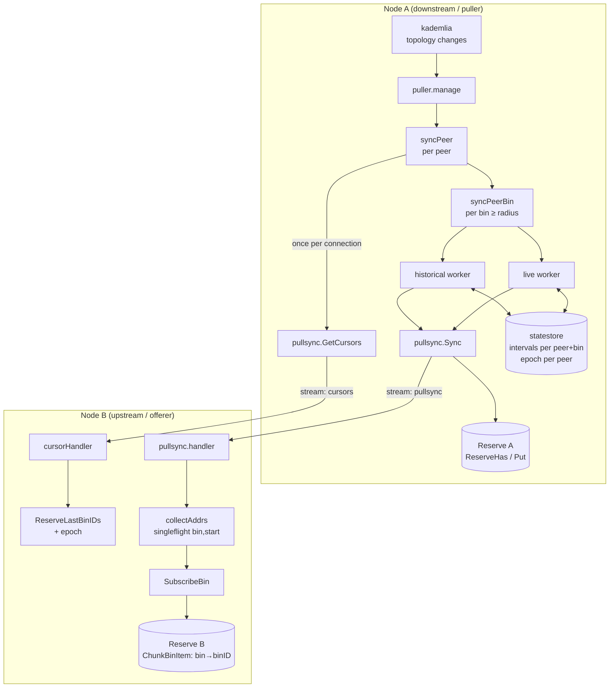

### 2.2 Flow A — peer connect, cursors and epoch

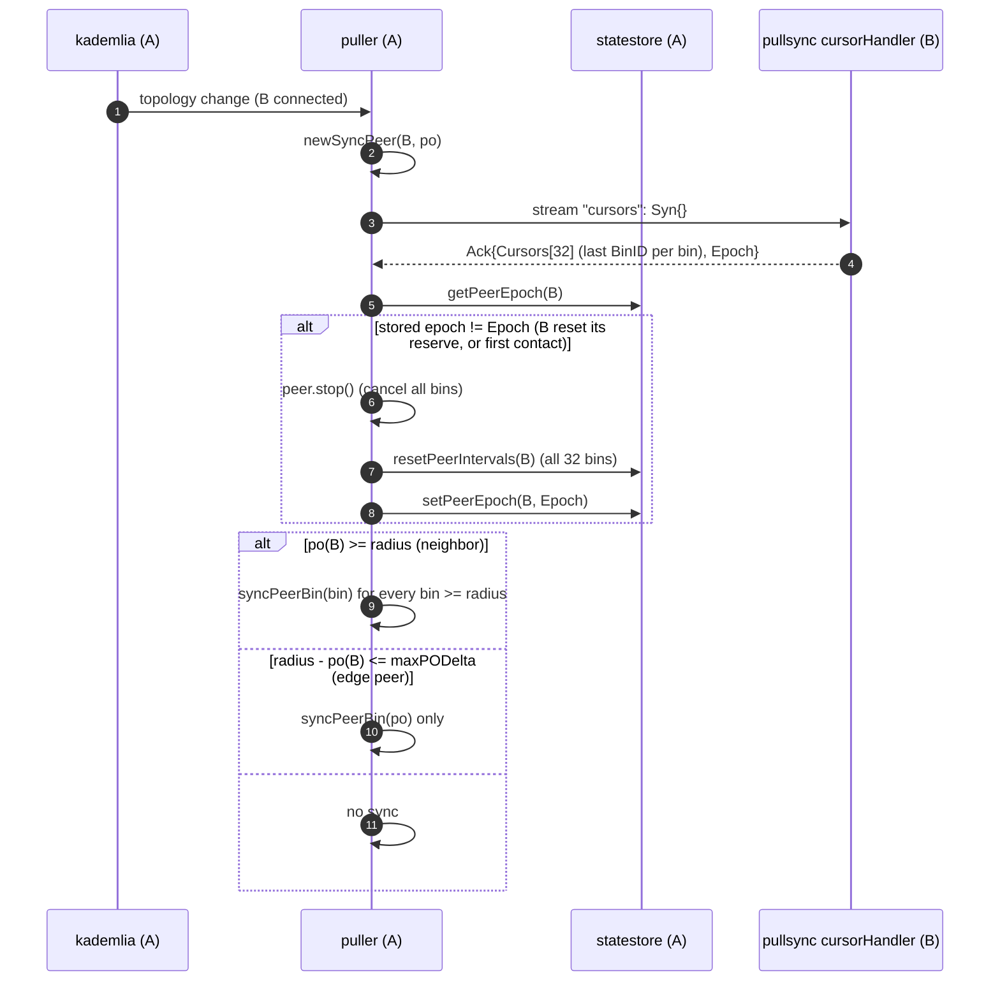

### 2.3 Flow B — one `Sync` call (one page of one bin)

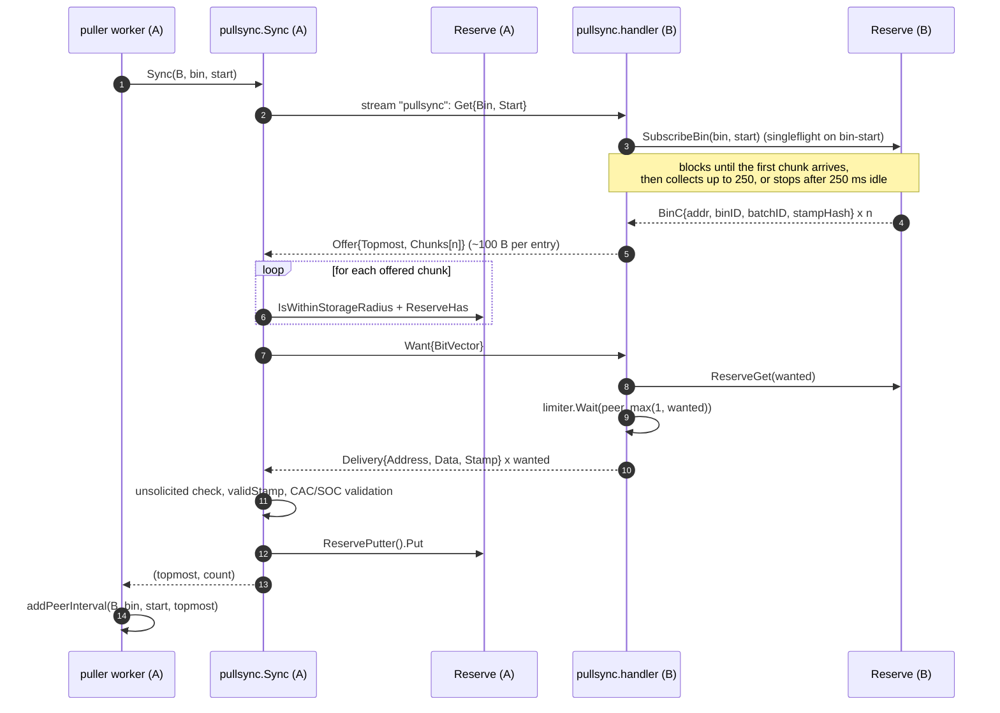

### 2.4 Flow C — historical and live workers per (peer, bin)

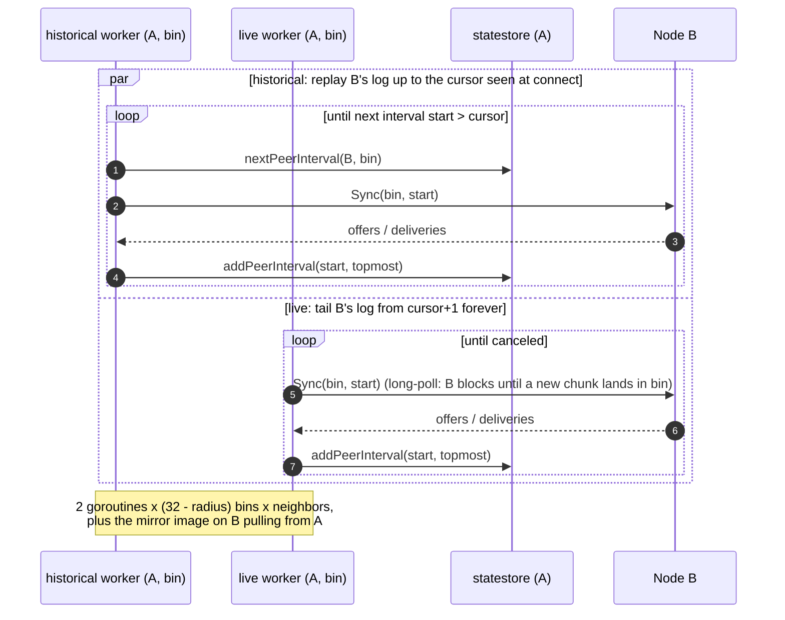

### 2.5 Flow D — radius decrease

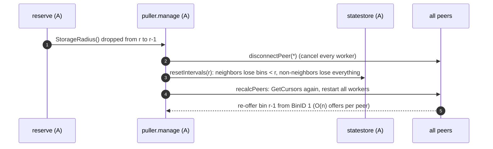

### 2.6 Problems

| # | Problem | Where | Consequence |
|---|---|---|---|
| P1 | The sync key (BinID) is local to each node | `reserve.IncBinID`, `pullsync.collectAddrs` | A peer's whole log must be replayed to learn its set: **O(n) per peer pair**, even when the sets are identical |
| P2 | Per-peer state that gets invalidated | `puller.resetPeerIntervals`, `resetIntervals`, epochs | Peer reserve reset or radius decrease forces a full replay. At 2²² chunks that is ~420 MB of offers **per neighbor** before any chunk moves (~3.4 GB with 8 neighbors) |
| P3 | Live sync offers every chunk from every neighbor | live worker + `SubscribeBin` | Each node receives *k* offers per new chunk, although pushsync already placed it on ~3 nodes (`maxMultiplexForwards = 2`) |
| P4 | Parallel sessions race | `ReserveHas` checked at offer time (`pullsync.go:291`) | The same chunk can be wanted and delivered by several peers at once (SREP's "redundant transmissions") |
| P5 | One direction only | `Sync` is a pull | Two sessions per pair. A stale-stamp divergence (`ErrOverwriteNewerChunk`) is never repaired, because the newer stamp is never sent back |
| P6 | Goroutine and stream fan-out | `syncPeerBin` | ~2 × (32 − r) × k long-lived workers and streams per node |

---

## 3. Goals and non-goals

**Goals**

1. Make sync cost proportional to the **difference** between two reserves (≈ O(n_Δ · log n)), not to their size.
2. Remove per-peer sync state, so restarts, reconnects and peer reserve resets cost nothing when sets match.
3. Transfer each missing chunk **once** per node, even when it is available from many neighbors.
4. Converge a neighborhood in **one round** in steady state (SREP: a neighborhood is a clique, diameter 1).
5. Resist fingerprint-collision attacks from uploaders (active adversaries).
6. Ship as an independent protocol next to `pullsync/1.4.0`, without modifying it. Operators switch each protocol on or off; a node can run `pullsync` only (default), `rangesync` only, or both.

**Non-goals**

- Changing pushsync, retrieval or the reserve's storage, eviction and stamp logic.
- Changing the redistribution game. The audit in §7.9 only *reads* round parameters.
- Sub-second live propagation. That remains pushsync's job (SREP's "out-of-band" principle).
- Modifying or removing `pullsync` / `puller`, the interval store, BinIDs or peer epochs. Both protocols run in parallel; a phase-out is planned separately once `rangesync` passes acceptance testing (§12).
- De-duplicating deliveries **between** `pullsync` and `rangesync` when both run on one node. Each protocol de-duplicates within itself; cross-protocol duplicates are measured (§10) and accepted.

---

## 4. Design overview

### 4.1 Core concepts

| Concept | Definition |
|---|---|
| **Element** | `id = addr (32 B) ‖ stampHash (32 B)`. `stampHash` = keccak256 of the marshaled stamp, which already includes the batch ID, so `id` is unique per (chunk, stamp) pair. The batch ID is stored as the index *value*. |
| **Order** | Lexicographic on `id`. It is the same on every node and prefix-aligned with Kademlia bins and neighborhoods. |
| **Range** | An address prefix `(prefix, bits)`: every element whose address starts with those `bits` bits. All ranges on the wire are prefixes, so Meyer's arbitrary `[x, y)` bounds are not needed. |
| **Root range** | `(base, StorageRadius)`: the node's neighborhood. |
| **Session root** | For peers A and B, the narrower of the two root ranges if one contains the other. If the ranges are disjoint, A and B do not sync (§7.6). |
| **Leaf (bucket)** | A range at depth `StorageRadius + LeafBits` (`LeafBits = 12` → 4096 buckets of ~1k chunks at 2²²). This is the smallest unit with cached summaries. |
| **Fingerprint** | LtHash16 (1024 × 16-bit lanes, lane-wise addition) of `SHAKE128("rangesync/v1" ‖ id)`. It is a group, so elements can be removed and range sums are Fenwick differences. On the wire it is sent as `Digest = keccak256(lthash)` (32 B). |
| **Coded symbol stream** | Rateless IBLT (Yang, Gilad, Alizadeh, SIGCOMM 2024). A range is encoded as an unbounded sequence of coded symbols `{sum [64]B, check [16]B, count}` (~82 B on the wire). It is linear, so streams of disjoint ranges combine symbol by symbol, and a peer reads only as many symbols as it needs to decode: on average 1.35–1.72 per difference. |
| **Symbol caches** | Prefixes of the coded symbol stream kept in memory: 4096 symbols for the root, 512 for each level-1 range, 32 per bucket (Fenwick). Ranges of at most 4096 elements can extend their stream on demand by scanning `ChunkAddrItem`. |

### 4.2 Architecture

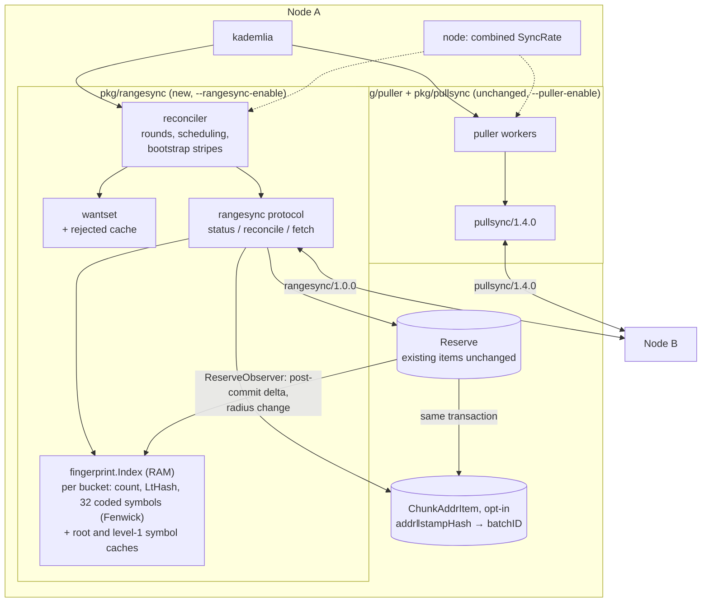

---

### 4.3 How the fingerprint blocks are built

This section walks through the data path from a chunk in the reserve to the 32-byte digest and the coded symbols that go on the wire.

#### 4.3.1 From chunk to element

Each (chunk, stamp) pair in the reserve becomes one **element**. Four values are derived from its `id`: the bucket it belongs to, its LtHash vector, the indices of the coded symbols it is mapped to, and its checksum.

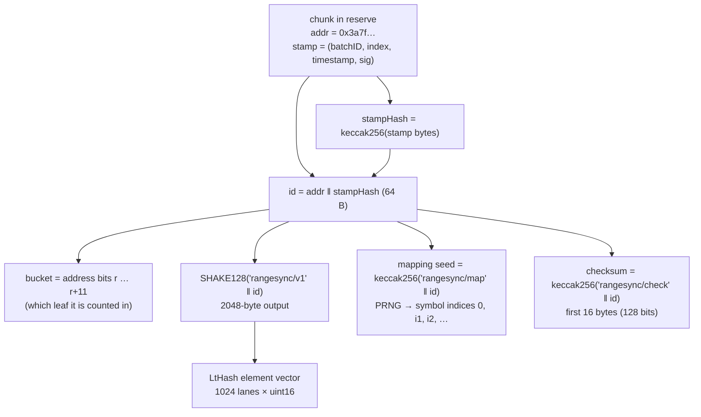

#### 4.3.2 Partitioning the address space

Ranges are address prefixes. The neighborhood prefix (the first `r` bits, where `r` is the storage radius) is shared by every neighbor. The next 12 bits split the neighborhood into a 16-way tree of depth 3, whose leaves are the buckets.

| Address bits | `0 … r−1` | `r … r+3` | `r+4 … r+7` | `r+8 … r+11` | remaining bits |
|---|---|---|---|---|---|
| Meaning | neighborhood prefix (root range) | level-1 range (16) | level-2 range (256) | bucket (4096) | order inside a bucket |
| Chunks per range (2²² reserve) | ~4.2M | ~262k | ~16k | ~1k | — |

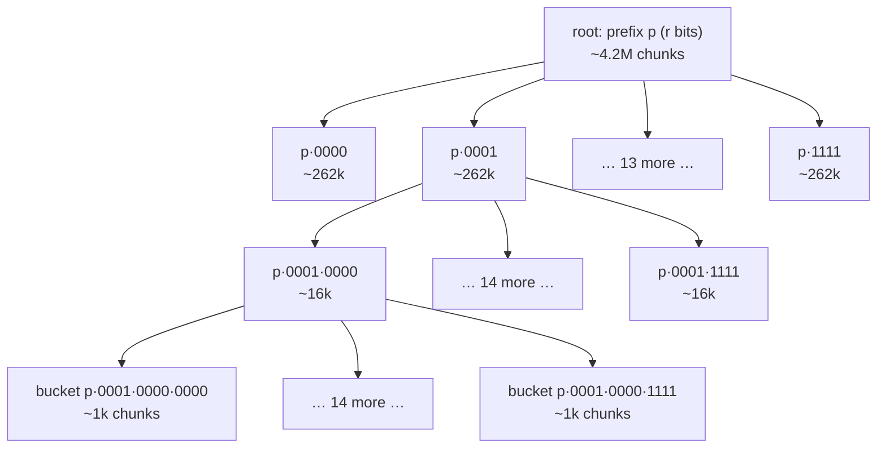

Buckets are stored in Fenwick trees. The root and the 16 level-1 ranges additionally keep longer symbol caches of their own (§4.3.5), because those are the ranges where most sessions start.

#### 4.3.3 What a bucket holds

Each bucket keeps three summaries of the elements in it. All three are **groups**: an element can be added and removed in any order, and the result depends only on which elements are present.

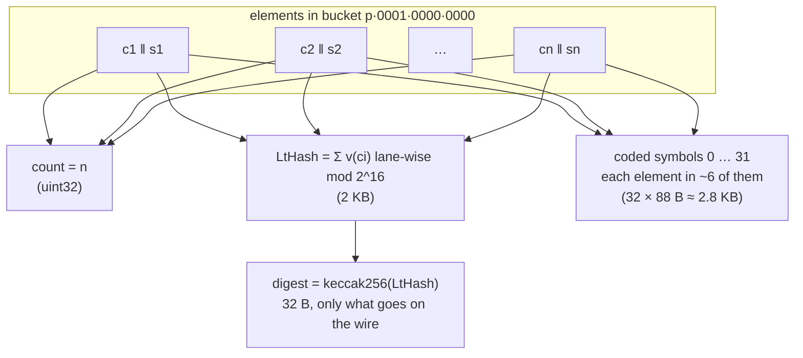

A toy LtHash with 4 lanes instead of 1024 shows why insertion order doesn't matter and why removal is exact:

| | lane 0 | lane 1 | lane 2 | lane 3 |
|---|---|---|---|---|
| v(c1) | `0x1A2B` | `0x0003` | `0xFF10` | `0x7000` |
| v(c2) | `0x0101` | `0xF000` | `0x00F5` | `0x9000` |
| bucket = v(c1) + v(c2) mod 2¹⁶ | `0x1B2C` | `0xF003` | `0x0005` | `0x0000` |
| evict c2: bucket − v(c2) | `0x1A2B` | `0x0003` | `0xFF10` | `0x7000` |

#### 4.3.4 How an element is mapped into coded symbols

A coded symbol is `{sum, check, count}`: the XOR of the `id`s mapped to it, the XOR of their checksums, and how many there are. Unlike a fixed IBLT, the sequence of coded symbols has no end. Element `e` is mapped to symbol `i` with probability

`ρ(i) = 1 / (1 + i/2)`

so every element is in symbol 0, about two thirds are in symbol 1, half in symbol 2, and the density keeps falling. Early symbols mix many elements, later symbols few, which is what lets a peeling decoder succeed for any difference size (Yang et al., §4.1).

| Symbol index `i` | 0 | 1 | 2 | 3 | 7 | 31 | 511 | 4095 |
|---|---|---|---|---|---|---|---|---|
| ρ(i) | 1 | 0.67 | 0.50 | 0.40 | 0.22 | 0.06 | 0.004 | 0.0005 |

| First `m` symbols | 32 | 512 | 4096 |
|---|---|---|---|
| Symbols an element is mapped to (expected) | ~6.2 | ~11.6 | ~15.8 |

The indices are not tested one by one. A PRNG seeded from the element's mapping seed draws the gap to the next index directly: from index `i`, with `u` uniform in `[0, 1)`,

`next = i + ⌈(1.5 + i) · ((1 − u)^(−1/2) − 1)⌉`

so producing all of an element's indices below `m` costs O(log m).

**The mapping is pluggable.** The index generator above and the expected-count function used by the wire codec (§6.2, `round(Count·ρ(i))`) sit behind one `Mapper` interface (§5.2). The first implementation uses `float64` as written here. Floating-point results are not guaranteed to be bit-identical across CPU architectures and compilers, and two nodes that map an element differently cannot decode each other's streams. So every `Mapper` has a numeric ID that is sent in `Status` (§6.2), sessions only run between peers with the same ID, and an integer/fixed-point `Mapper` can replace the float one later without changing anything else. Cross-architecture test vectors (amd64, arm64) guard the float version until then.

Example for element `c7‖s7`:

| Step | from `i` | `u` (PRNG) | gap | next index |
|---|---|---|---|---|
| start | — | — | — | 0 |
| 1 | 0 | 0.50 | ⌈1.5 × 0.414⌉ = 1 | 1 |
| 2 | 1 | 0.70 | ⌈2.5 × 0.826⌉ = 3 | 4 |
| 3 | 4 | 0.60 | ⌈5.5 × 0.581⌉ = 4 | 8 |
| 4 | 8 | 0.80 | ⌈9.5 × 1.236⌉ = 12 | 20 |
| 5 | 20 | 0.30 | ⌈21.5 × 0.195⌉ = 5 | 25 |

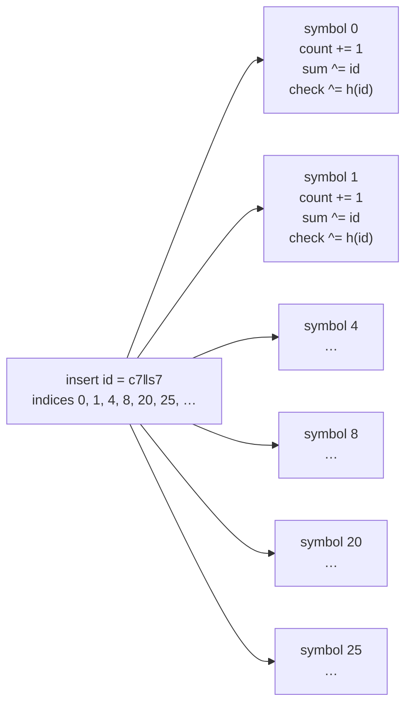

Removing the element applies the same XORs with `count −= 1`. Because the mapping depends only on the element, two nodes that hold the same element put it in the same symbols, and the symbol-by-symbol difference of their streams is exactly the stream of the set difference (**linearity**).

#### 4.3.5 Answering a range query

**Fingerprints and counts.** A range at level 0–3 maps to a contiguous run of buckets. The index keeps a **Fenwick tree** over the buckets, so any run is the difference of two prefix sums, each built from O(log B) stored nodes. The figure shows 8 buckets (1-indexed). Each Fenwick node `Fi` stores the sum of the buckets in brackets.

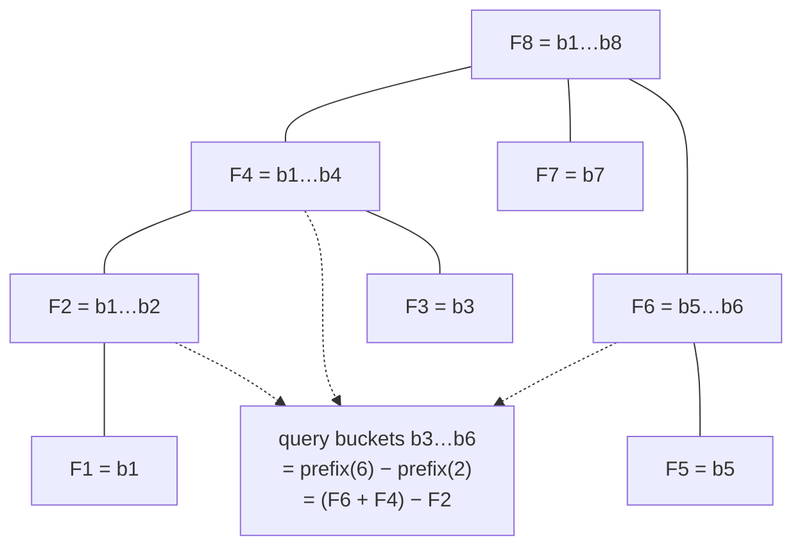

For B = 4096 a query touches at most 24 stored nodes. That's 24 vector operations over 1024 lanes, a few microseconds.

**Coded symbols.** The bucket Fenwick tree also holds the first 32 coded symbols of every bucket, so the first 32 symbols of any bucket-aligned range come from the same prefix-sum trick. Longer streams come from three other sources:

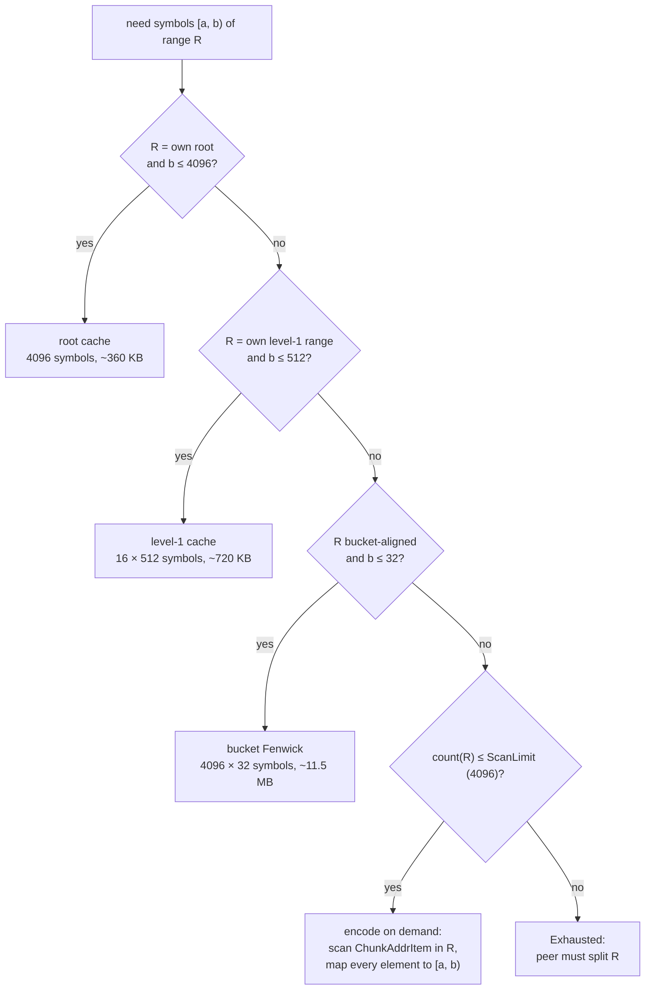

| Range | Symbols available | Differences it can resolve (≈ symbols / 1.4) |
|---|---|---|
| Own root | 4096 | ~2,900 |
| Own level-1 range | 512 | ~360 |
| Any other bucket-aligned range | 32 | ~22 |
| Any range with ≤ 4096 elements (a bucket, a few buckets, a narrow edge-peer root) | unlimited | any (an item list is cheaper once the difference passes ~half the range) |

#### 4.3.6 Keeping the index current

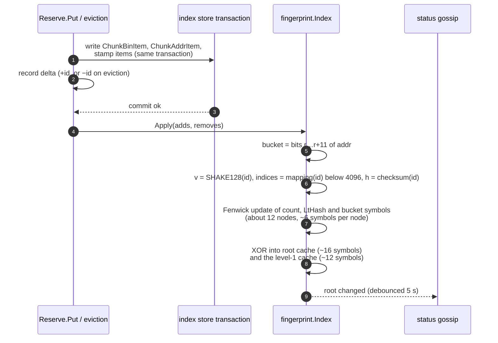

About 100 symbol XORs of 88 B plus one SHAKE expansion per update: a few microseconds.

#### 4.3.7 Decoding a coded-symbol stream

The requester receives a batch of the peer's coded symbols for range R, subtracts its own symbols at the same indices (XOR for `sum` and `check`, subtraction for `count`), and peels. A symbol is **pure** when exactly one element is left in it: `count = ±1` and `check = h(sum)`. `+1` means the element is only local, `−1` only remote. Each recovered element is removed from every other symbol it maps to, which can make more symbols pure. Because every element is in symbol 0, **symbol 0 becomes empty exactly when the whole difference is recovered** — that is the stop signal.

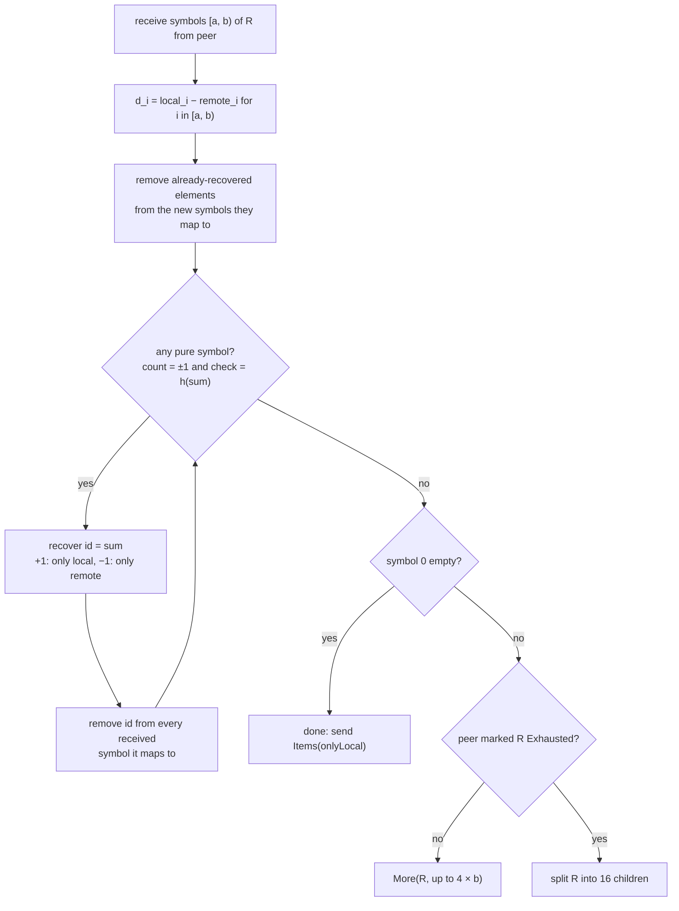

A tiny example: A and B differ by `x` (only on A) and `y`, `z` (only on B). Their mappings are `x → {0, 1}`, `y → {0, 2}`, `z → {0, 1, 3}`. After subtracting, A sees:

| Step | s0 | s1 | s2 | s3 | Recovered |
|---|---|---|---|---|---|
| after subtraction | x, y, z (count −1) | x, z (count 0) | y (count −1) | z (count −1) | — |
| s2 is pure | x, z (count 0) | x, z | — | z | y only on B |
| s3 is pure | x (count +1) | x (count +1) | — | — | z only on B |
| s0 is pure | — | — | — | — | x only on A |

Four symbols resolved three differences, and the empty symbol 0 told A it was done. Averaged over many runs the cost is 1.35–1.72 symbols per difference (it peaks at 1.72 for a difference of 4 and approaches 1.35 for differences in the hundreds).

---

## 5. Storage layer

### 5.1 New index: `ChunkAddrItem`

```go
// pkg/storer/internal/reserve/items.go

// ChunkAddrItem orders reserve chunks by address for range reconciliation.
type ChunkAddrItem struct {
	Address   swarm.Address
	StampHash []byte
	BatchID   []byte
	ChunkType swarm.ChunkType
}

func (c *ChunkAddrItem) Namespace() string { return "chunkAddr" }

// addr/stampHash
func (c *ChunkAddrItem) ID() string { return c.Address.ByteString() + string(c.StampHash) }

// Marshal encodes BatchID (32 B) + ChunkType (1 B) as the value.
```

The item is **opt-in**: the reserve maintains it only when the storer is opened with the address index enabled (which the node does when `--rangesync-enable` is set). Nodes that never enable `rangesync` pay no disk or write cost. When enabled, it is written and deleted in the **same transaction** as `ChunkBinItem`:

| Path | File | Change |
|---|---|---|
| `Reserve.Put`: new chunk | `reserve.go` | Put `ChunkAddrItem`, record delta `+id` |
| `Reserve.Put`: same address, newer stamp | `reserve.go` | Delete old, put new, record deltas `−old +new` |
| `Reserve.Put`: different address, same stamp index | `reserve.go` → `removeChunk` | Covered by `RemoveChunkWithItem` |
| `RemoveChunkWithItem`, `RemoveChunkMetaData` (eviction) | `reserve.go` | Delete `ChunkAddrItem`, record delta `−id` |
| `DeleteCorruptedChunkMetadata` | `reserve.go` | Delete `ChunkAddrItem`, record delta `−id` |
| `Reset` | `reserve.go` | Drop the namespace, notify the observer |
| `ReserveRepairer` (db repair command) | `migration/reserveRepair.go` | Drop the namespace and the validity marker, so the next enabled start refills it |

Disk cost: ~4.2M × ~80 B ≈ **350 MB** at full capacity. One extra key on top of the ~5 that `Put` already writes.

**Filling and toggling.** Because the index is opt-in, it is not a numbered migration (numbered steps run on every node). Instead a marker item `chunkAddrValid` records that the namespace is complete:

| Start-up with | Marker present | Action |
|---|---|---|
| address index enabled | yes | nothing, the index is current |
| address index enabled | no | drop the namespace, fill it from `ChunkBinItem`, write the marker |
| address index disabled | yes | delete the marker (writes stop now, so the namespace becomes stale), then drop the namespace in the background to reclaim the disk space |
| address index disabled | no | nothing |

So turning `rangesync` off and on again costs one refill, and a stale index can never be served.

**Blocking or background fill.** The fill runs before the reserve workers start, blocking start-up, as long as it takes under 60 s on a full reserve (~4.2M chunks; measured in plan task T1.5). If it takes longer, it runs in the background instead: writes maintain `ChunkAddrItem` from the moment the node starts, the filler takes the reserve's per-batch lock for each item and re-checks that its `BatchRadiusItem` still exists before writing it (so a chunk evicted during the fill is never resurrected), and `rangesync` answers `Busy` until the marker is written. Either way the marker is written last, so a crash during the fill leads to a clean refill on the next start.

A build without `rangesync` does not know the namespace, so leftover keys after a downgrade stay on disk (~80 B per chunk) until the node is upgraded again and starts with `rangesync` disabled.

### 5.2 In-memory fingerprint index

```go
// pkg/rangesync/fingerprint (new package, no dependency on pkg/storer)

type ID [64]byte // addr ‖ stampHash

type LtHash [1024]uint16
func (h *LtHash) Add(id ID)
func (h *LtHash) Sub(id ID)
func (h *LtHash) AddHash(o *LtHash)
func (h *LtHash) SubHash(o *LtHash)
func (h *LtHash) Digest() [32]byte

// CodedSymbol is one symbol of a Rateless IBLT stream.
type CodedSymbol struct {
	Sum   ID       // XOR of the ids mapped to this symbol
	Check [16]byte // XOR of their 128-bit checksums
	Count int64    // number of ids mapped (signed after subtraction)
}

// Mapper defines how ids are spread over coded symbols (§4.3.4). It is
// pluggable so the float64 implementation can be replaced by an integer one.
type Mapper interface {
	ID() uint32                       // sent in Status; peers must agree
	Indices(id ID) IndexIterator      // increasing symbol indices, starting at 0
	Expected(count uint64, i uint64) int64 // round(count·ρ(i)), used by the wire codec
}

type IndexIterator interface{ Next() uint64 }

// FloatMapper is the first implementation (Mapper ID 1): PRNG seeded from
// keccak256("rangesync/map" ‖ id), gap formula of §4.3.4 in float64.
type FloatMapper struct{}

// Encode XORs id into syms[i] for every mapped index i in [start, start+len(syms)).
func Encode(m Mapper, syms []CodedSymbol, start uint64, id ID, sign int64)

// Decoder peels a symbol stream incrementally. It is fed the peer's symbols
// batch by batch, together with the local symbols at the same indices.
type Decoder struct{ /* received symbols, recovered ids, pure-symbol queue */ }
func (d *Decoder) Add(start uint64, remote, local []CodedSymbol) error
func (d *Decoder) Done() bool // symbol 0 is empty
func (d *Decoder) Result() (onlyLocal, onlyRemote []ID)

type Range struct {
	Prefix swarm.Address
	Bits   uint8
}

type Summary struct {
	Count  uint64
	Digest [32]byte
}

// Index caches per-bucket summaries and symbol streams under a root range.
type Index struct {
	mu        sync.RWMutex
	mapper    Mapper // fixed at construction (§4.3.4)
	root      Range
	leafBits  uint8
	counts    fenwick[uint32]
	hashes    fenwick[LtHash]
	bucketSym fenwick[[BucketSymbols]CodedSymbol] // 32 per bucket
	level1Sym [16][Level1Symbols]CodedSymbol      // 512 per level-1 range
	rootSym   [RootSymbols]CodedSymbol            // 4096 for the root
}

func (ix *Index) Apply(adds, removes []ID)
func (ix *Index) Summary(r Range) (Summary, error) // r.Bits <= root.Bits+leafBits
// Symbols returns symbols [start, end) of r from the best cache (§4.3.5).
// exhausted is true when no source can go past the returned symbols.
func (ix *Index) Symbols(r Range, start, end uint64) (syms []CodedSymbol, exhausted bool, err error)
func (ix *Index) Rebuild(root Range, iterate func(func(ID) error) error) error
```

- **Fenwick trees** over a flat bucket slab. A range at or above leaf depth maps to a contiguous run of buckets, so its value is `prefix(j) − prefix(i)` in O(log B) operations. This works for counts, LtHash and coded symbols because all three are groups.
- **Root and level-1 caches** are plain arrays updated on every `Apply`. They are only valid for the node's own root and its 16 level-1 ranges. Any other range (for example a narrower session root with an edge peer) uses the bucket Fenwick tree and the scan path.
- **Scan path.** For a range with at most `ScanLimit = 4096` elements, `Symbols` iterates `ChunkAddrItem` in the range and encodes on demand. This makes buckets and other small ranges effectively unlimited, so the protocol never has to split below leaf depth.
- **Below leaf depth** (needed only when a peer's leaves are deeper): the same scan path serves summaries too. The scan is at most one bucket of ~1k items.
- **Updates.** Deltas are collected inside the `r.st.Run` closure and handed to the registered `storer.ReserveObserver` (§5.4) after the transaction returns `nil`; `pkg/rangesync` implements the observer and calls `Index.Apply`. `EvictBatchBin` delivers them per committed transaction. With no observer registered (rangesync disabled) this is a no-op.
- **Rebuild** happens at startup and when `StorageRadius` changes (the root and the bucket grid move). It always runs **asynchronously**: `RadiusChanged` only queues a rebuild (a no-op if the radius equals the Index root's) and returns, because `SetRadius` is called from the reserve worker and from `unreserve`, and a synchronous 10–20 s rebuild would stall eviction or deadlock against writers waiting for `ix.mu`. Start-up order: register the observer, then run the initial rebuild from the persisted radius, so no commit is missed. The first rebuild waits until the address index is complete (`ReserveAddrIndexReady()`); until then the observer drops deltas and `rangesync` answers `Busy`. Steps:
  1. Take `ix.mu.Lock()`, open a LevelDB iterator over `chunkAddr` (goleveldb iterators read from an implicit snapshot), then release the lock.
  2. Build the new slab from the iterator.
  3. Commits that land after the iterator was opened apply their deltas to both the old and the new slab.
  4. Writers hold `ix.mu.RLock()` across commit and apply, so every commit is either in the snapshot or in the delta stream, never both.
  5. Swap the slabs. `rangesync` answers `Busy` for ranges not yet covered while a rebuild runs.

  **Lock ordering.** Writers already hold the reserve's per-batch and per-bin locks when they enter `ReserveObserver.Commit` and take `ix.mu.RLock()`. So the Index must never call into the reserve (or wait on anything that does) while it holds `ix.mu` in write mode: step 1 opens the iterator and releases the lock immediately, and iteration happens without it. The Phase-1 spike (plan task T1.0) confirms that the iterator really reads a snapshot through `transaction.Storage` and the caching layer before the observer interface is fixed.

  At 4.2M elements a rebuild does ~4M SHAKE expansions and ~140M symbol XORs: roughly 10–20 s of CPU, off the hot path.
- **Change notification:** a `SubscribeRootChange()` channel on the Index, debounced, drives status gossip. Radius changes reach the Index through the observer's `RadiusChanged` callback, which queues the rebuild.

### 5.3 Memory budget (B = 4096 buckets, reserve full)

| Component | Size |
|---|---|
| Counts (Fenwick) | 16 KB |
| LtHash16 (Fenwick) | 8 MB |
| Bucket symbols, 4096 × 32 × 88 B (Fenwick) | 11.5 MB |
| Level-1 symbols, 16 × 512 × 88 B | 0.7 MB |
| Root symbols, 4096 × 88 B | 0.36 MB |
| Session buffers and decoders (≤ 16 sessions) | ≤ 2 MB |
| In-flight want set (≤ 10k IDs) | ≈ 1.2 MB |
| **Total** | **≈ 21 MB steady, ≈ 24 MB peak** |

`BucketSymbols` is the main lever: 16 symbols per bucket saves ~6 MB at the cost of descending one more level for bucket runs with more than ~11 differences. Using ECMH instead of LtHash saves another ~8 MB at a higher CPU cost per update. Both are benchmarked in Phase 1.

### 5.4 Storer API

The storer stays ignorant of fingerprints. It exposes only storage-level primitives; summaries and symbol streams are served by `pkg/rangesync` from its own Index.

```go
// pkg/storer/storer.go (additive)

// ChunkID identifies one (chunk, stamp) pair in the reserve.
type ChunkID struct {
	Address   swarm.Address
	StampHash []byte
	BatchID   []byte
}

// ReserveAddrStore is implemented by the storer when the address index is enabled.
type ReserveAddrStore interface {
	// ReserveIterateAddr iterates ChunkAddrItem in address order under the given
	// prefix (prefix, bits), starting strictly after `after` (nil = from the start).
	ReserveIterateAddr(prefix swarm.Address, bits uint8, after []byte, cb func(ChunkID) (stop bool, err error)) error
	ReserveGetByID(ctx context.Context, addr swarm.Address, stampHash []byte) (swarm.Chunk, error)
	// ReserveHasID reports whether (addr, stampHash) is in the reserve. Peers exchange
	// ids without the batch ID, so ReserveHas (which needs it) cannot be used.
	ReserveHasID(addr swarm.Address, stampHash []byte) (bool, error)
	// ReserveAddrIndexReady reports whether the address index is complete (its
	// validity marker is written). Until then rangesync answers Busy.
	ReserveAddrIndexReady() bool
	// SetReserveObserver registers the single observer of reserve set changes.
	SetReserveObserver(o ReserveObserver)
}

// ReserveObserver receives every committed change of the reserve's (addr, stampHash) set.
type ReserveObserver interface {
	// Commit wraps every reserve transaction that changes the set. It must call run
	// exactly once; run executes the transaction and returns the delta it committed
	// (empty when it failed). The delta is exact: an id is in removes only if its
	// ChunkAddrItem existed and was deleted in this transaction, and in adds only if
	// it was written. A wrong remove would subtract an element the Index never added
	// and leave a phantom difference forever. Holding a read lock around run is what
	// gives the rebuild protocol of §5.2 its "snapshot or delta stream, never both"
	// guarantee.
	Commit(run func() (adds, removes []ChunkID, err error)) error
	// RadiusChanged is called after the reserve radius changed. It must not block:
	// the implementation queues an asynchronous rebuild and returns.
	RadiusChanged(radius uint8)
	// Reset is called after the reserve was reset.
	Reset()
}
```

`ReserveGetByID` resolves `BatchID` from `ChunkAddrItem` and calls the existing `ReserveGet`. The Index (root, summaries, symbols, `SubscribeRootChange`) is a `pkg/rangesync` type built from `ReserveIterateAddr` and kept current through the observer.

The Rateless IBLT reference implementation is a self-contained Go library of about 350 lines. Following the repository's dependency policy, the encoder and decoder are implemented in-tree in `fingerprint/rateless.go` rather than added as a module dependency, with our own per-`Mapper` test vectors (§13).

---

## 6. Wire protocol: `rangesync/1.0.0`

### 6.1 Streams

| Stream | Direction | Purpose |
|---|---|---|
| `status` | either side → peer | Gossip the root summary when it changes (debounced to `StatusMinInterval = 5s`) and as a heartbeat (`StatusMaxInterval = 60s`) |
| `reconcile` | initiator → responder | One reconciliation session. Messages alternate until one side sends an empty message |
| `fetch` | requester → holder | `Want` a list of IDs, receive `Delivery` messages. Used by both sides of a session |

### 6.2 Messages

```proto
syntax = "proto3";

package rangesync;

option go_package = "pb";

message Range {
  bytes  Prefix = 1; // ceil(Bits/8) bytes
  uint32 Bits = 2;
}

message Status {
  Range  Root = 1;      // sender's neighborhood: (overlay prefix, StorageRadius)
  uint64 Count = 2;
  bytes  Digest = 3;    // 32 B
  uint32 LeafBits = 4;  // sender's bucket depth below Root
  uint64 AuditRound = 5;
  bytes  AuditDigest = 6; // §7.9, empty when not yet computed
  uint32 Mapping = 7;     // Mapper ID (§4.3.4); sessions require equal values
}

message Fingerprint {
  Range  Range = 1;
  uint64 Count = 2;
  bytes  Digest = 3;    // omitted when Count == 0
}

// Symbols carries coded symbols [Start, Start+n) of the sender's stream for Range.
message Symbols {
  Range  Range = 1;
  uint64 Count = 2;      // sender's element count in Range
  uint64 Start = 3;
  bytes  Data = 4;       // n x (Sum 64 B ‖ Check 16 B ‖ varint zigzag(count − round(Count·ρ(i))))
  bool   Exhausted = 5;  // the sender cannot produce symbols past this batch
}

// More asks the peer to continue its stream for Range up to (excluding) UpTo.
message More {
  Range  Range = 1;
  uint64 UpTo = 2;
}

message ID {
  bytes Address = 1;
  bytes StampHash = 2;
}

message Items {
  Range       Range = 1;
  repeated ID IDs = 2;
  bytes       After = 3;   // paging cursor (last ID of the previous page)
  bool        More = 4;    // more pages follow on this stream
  bool        Reply = 5;   // Meyer's flag: receiver must answer with its own items in Range
}

message Part {
  oneof Kind {
    Fingerprint FP = 1;
    Symbols     Symbols = 2;
    More        More = 3;
    Items       Items = 4;
  }
}

message Message {
  repeated Part Parts = 1;  // <= MaxParts (1024), <= MaxMessageBytes (1 MiB)
  bool          Busy = 2;   // responder is rebuilding, filling its address index, or over its session cap
  uint64        AuditRound = 3; // §7.9 salted session: set in the first message only; 0 = normal session.
                                // Fingerprints then use the anchor of that round as salt.
}

// fetch stream
message Want {
  repeated ID IDs = 1;      // <= 250
}

message Delivery {
  bytes Address = 1;
  bytes Data = 2;
  bytes Stamp = 3;
}
```

Approximate wire sizes: `Fingerprint` ≈ 55 B, one coded symbol ≈ 82 B (the count is sent as a small difference from its expected value `Count·ρ(i)`, ~1–2 B, as in the reference implementation), `ID` ≈ 70 B.

### 6.3 Per-range decision rule

Both sides apply the same rule to every incoming `Fingerprint` part. It is a pure function in `pkg/rangesync/session.go`, so it can be unit-tested and fuzzed on its own.

**Capacity.** `cap(R)` is the number of symbols *both* peers can produce for R (§4.3.5): 4096 if R is the root of both, 512 if it is a level-1 range of both, unlimited if both hold at most `ScanLimit` elements in R, otherwise 32. Each side computes it for both peers from the `Status` it received and the counts in the `Fingerprint`, so no extra negotiation is needed.

**Estimate.** `d̂ = max(|cL − cR|, hint(R), 1)`, where `hint(R)` is the size of the last decoded difference for this range and peer, if any. The first batch has `n0 = max(MinBatch, ⌈1.6 · d̂⌉ + 2)` symbols.

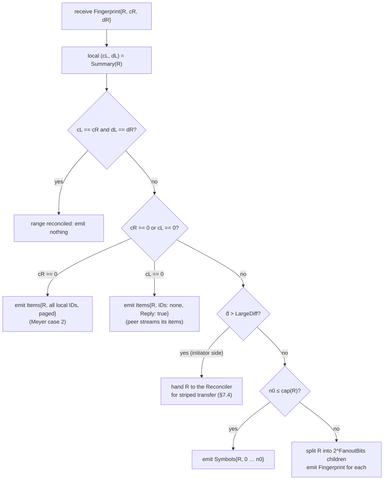

Receiving the other part types:

| Incoming part | Action |
|---|---|
| `Symbols{R, …}` | Feed the batch and the local symbols at the same indices to R's `Decoder`. **Decoded** (symbol 0 empty): queue `onlyRemote` for fetch and emit `Items{R, onlyLocal, Reply: false}`. **Not decoded, not `Exhausted`:** emit `More{R, UpTo: min(4 × received, cap(R))}`. **Not decoded, `Exhausted`:** split R and emit child `Fingerprint`s. The received symbols are discarded, which is the only case where symbols are wasted. |
| `More{R, UpTo}` | Emit the next batch `Symbols{R, Start: sent, …}` up to `UpTo`, with `Exhausted` set when `cap(R)` is reached. |
| `Items{R, IDs, Reply}` | Queue the IDs the node doesn't hold for fetch. If `Reply`, emit `Items{R, local IDs not in IDs, Reply: false}`. Paging continues while `More`. |

Session leaf depth = `min(Root.Bits + LeafBits)` over both peers (exchanged in `Status`). Because ranges of at most `ScanLimit` elements have unlimited streams, sessions never need to descend below it.

Constants: `FanoutBits = 4` (16 children), `RootSymbols = 4096`, `Level1Symbols = 512`, `BucketSymbols = 32`, `ScanLimit = 4096`, `MinBatch = 4`, batch factor 1.6, growth factor 4, `MaxParts = 1024`, `MaxMessageBytes = 1 MiB`, `ItemsPageSize = 1024`, `LargeDiff = 65536`.

### 6.4 Validation and limits

- Every incoming `Range` must lie inside the session root and be at most leaf depth (or at most 4 bits deeper, to allow a peer with deeper leaves). Otherwise the stream is reset and the peer is disconnected, as `pullsync` does today, and its failure score in the reconciler is raised. `rangesync` does not blocklist; that can be added later if disconnects prove insufficient.
- A `Fingerprint` child set must partition a range the receiver sent in the previous message. This blocks requests for arbitrary ranges that would amplify CPU work.
- `More` is only valid for a range the receiver is already streaming in this session, with `UpTo ≤ cap(R)`. Each session has a symbol budget (`SessionSymbolBudget = 16384`, ~1.3 MB); past it the responder answers `Exhausted` for every range.
- Symbols served from the scan path cost CPU on the responder, so at most `MaxScansPerMessage = 64` ranges per message may use it.
- The `Decoder` stops and reports corruption if a recovered id lies outside R, if the same id is recovered twice, or after `2 × received` peel steps. A corrupted range falls back to an exact item listing (§9).
- `MaxParts` and `MaxMessageBytes` per message, `MaxConcurrentSessions = 16` per node and 1 per peer. Sessions over the cap get `Busy`.
- Delivery validation applies the same rules as `pullsync.Sync` (implemented in `pkg/rangesync`, `pullsync` is not touched): unsolicited check, `validStamp`, CAC/SOC checks, `ReservePutter().Put`, plus a per-peer delivery rate limiter of its own.

---

## 7. Sync flows (new design)

### 7.1 Steady state: synced neighbors

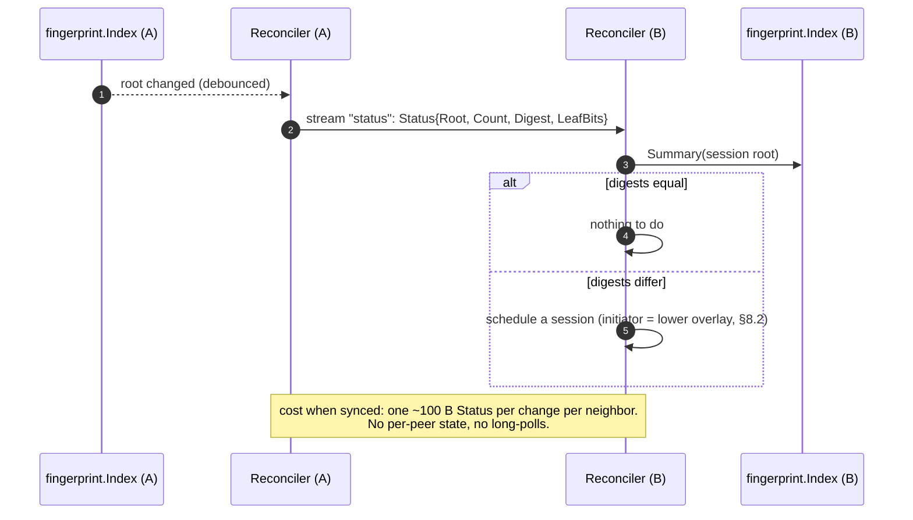

### 7.2 Small or medium difference: one symbol stream from the root

Any difference whose first batch fits in the root cache (an estimate of up to ~2,500 elements; the cache itself can decode up to ~2,900 when the estimate is low) is resolved directly from the root, without range descent.

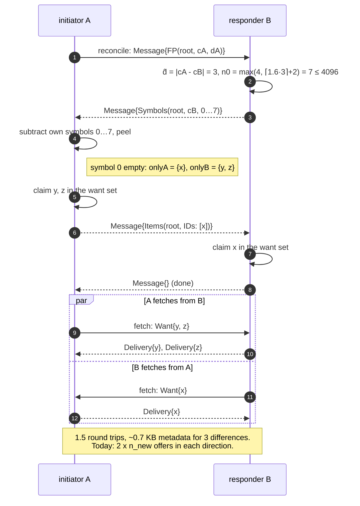

If the first batch is too short, A sends `More(root, UpTo: 4 × 7 = 28)` and B continues the same stream from symbol 7. Nothing already received is wasted, and the extra round trip is the only cost of a low estimate.

### 7.3 Large difference: one split, then level-1 streams

When a difference does not fit in the root cache (`n0 > 4096`, i.e. more than ~2,500 differences by the count estimate), the responder splits once. Each level-1 range then has its own 512-symbol stream. Only ranges whose difference still doesn't fit descend further, and from leaf depth on, streams are unlimited (scan path).

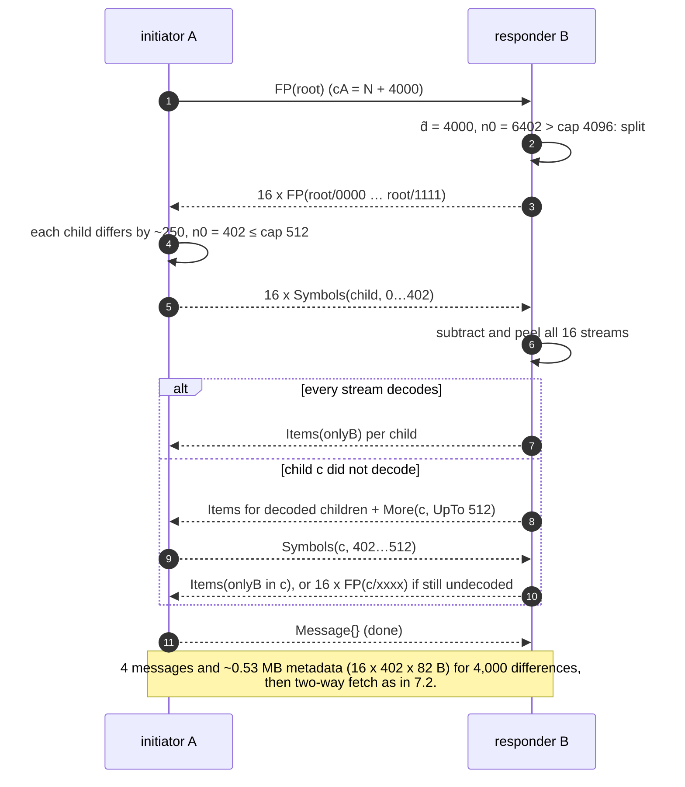

### 7.4 Bootstrap or large difference: striped transfer and verification

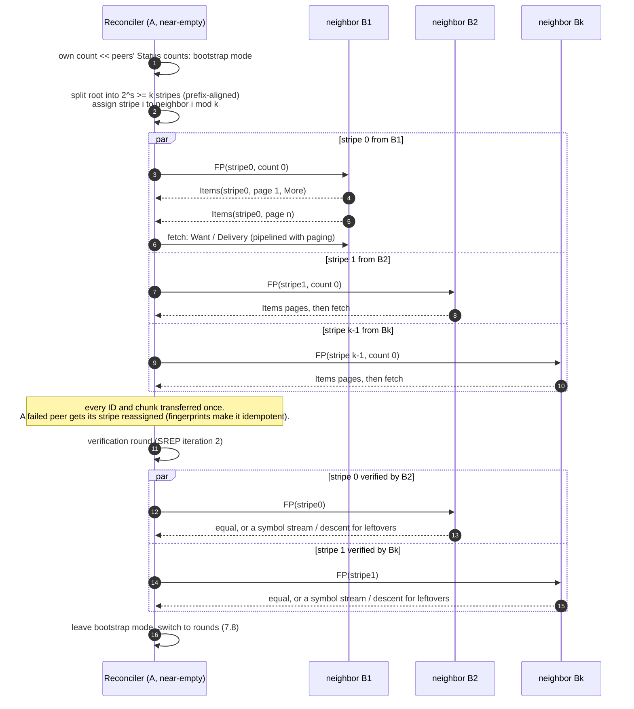

Compared with today, with 2²² chunks and 8 neighbors:

| | Today | `rangesync` |
|---|---|---|
| ID metadata received | ~3.4 GB (every neighbor offers everything) | ~270 MB (each ID once) + a few KB verification |
| Chunk data | ≥ 17 GB, with racing duplicates | 17 GB, each chunk once |
| Per-peer state written | 32 intervals + epoch per neighbor | none |

### 7.5 Radius decrease

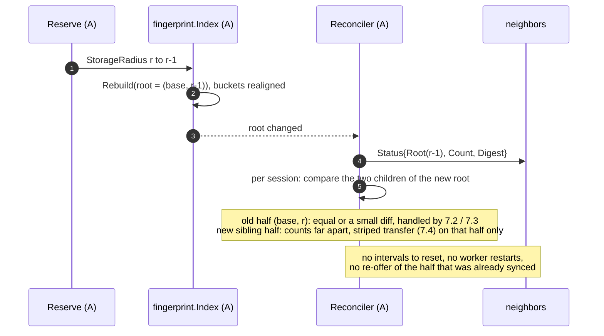

Radius increase only narrows the root. Evicted chunks leave the fingerprints through the normal eviction deltas, and nothing is transferred.

### 7.6 Edge peers (nested neighborhoods)

```mermaid
flowchart TD
    S["Status from B: RootB = (B, rB)"] --> C{"relation of RootA = (A, rA) and RootB"}
    C -- "RootA contains RootB<br/>(rA ≤ rB, same prefix)" --> SB["session root = RootB<br/>(A syncs only the part B is responsible for)"]
    C -- "RootB contains RootA<br/>(rB ≤ PO(A,B) ≤ rA − 1)" --> SA["session root = RootA<br/>(edge peer with a smaller radius covers A's neighborhood)"]
    C -- "disjoint" --> NO["no sync with B"]
```

`rangesync` uses this rule instead of `puller`'s `maxPODelta` special case and "sync only the PO bin" logic (`puller.go:315`), which stay as they are for `pullsync`. Eligibility follows directly from whether the two neighborhoods overlap.

### 7.7 Stale-stamp divergence (two-way exchange)

```mermaid
sequenceDiagram
    autonumber
    participant A as Node A (stamp s1 for chunk c)
    participant B as Node B (newer stamp s2 for chunk c)
    A->>B: FP(R)
    B-->>A: Symbols(R, 0…7)
    A->>A: subtract and peel: onlyA = {c‖s1}, onlyB = {c‖s2}
    A-->>B: Items(R, [c‖s1])
    par
        A->>B: Want{c‖s2}
        B-->>A: Delivery(c, s2)
        A->>A: Put replaces s1 with s2 (newer timestamp), index -s1 +s2
    and
        B->>A: Want{c‖s1}
        A-->>B: Delivery(c, s1)
        B->>B: Put returns ErrOverwriteNewerChunk, add c‖s1 to the rejected cache (TTL)
    end
    Note over A,B: next round: digests equal. Today A never learns about s2.
```

### 7.8 Rounds across all neighbors with de-duplication (SREP)

```mermaid
sequenceDiagram
    autonumber
    participant A as Reconciler (A)
    participant W as want set (A)
    participant B1 as neighbor B1
    participant B2 as neighbor B2
    participant B3 as neighbor B3
    Note over A,B3: round t: every session reads the same index snapshot
    par
        A->>B1: session: decoded onlyB1 = {x, y}
        A->>W: claim(x), claim(y) both granted
        A->>B1: Want{x, y}
    and
        A->>B2: session: decoded onlyB2 = {x, z}
        A->>W: claim(x) denied (held by B1), claim(z) granted
        A->>B2: Want{z}
    and
        A->>B3: session: digests equal
    end
    alt B1 fails to deliver x before the claim deadline
        W-->>A: release(x)
        A->>B2: Want{x} (retry from a peer that has it)
    end
    Note over A,B3: neighborhood is a clique, so I = 1 round (SREP Lemma 2).<br/>Each missing chunk is fetched once per node (no Theorem 1 redundancy).
```

**Live-traffic cost model** (per new chunk, neighborhood of N nodes, pushsync places it on p ≈ 3 nodes):

| | Today | `rangesync` rounds (rateless) |
|---|---|---|
| Metadata | every node receives *N − 1* offers × 100 B | only (has, lacks) pairs carry it: p·(N − p) × ~1.35–1.72 coded symbols × 82 B ≈ 110–140 B |
| N = 9 | ~7.2 KB | ~2.0–2.5 KB |
| N = 17 | ~27 KB | ~4.6–5.9 KB |
| Fill latency | ~250 ms (long-poll page) | one round (`RoundInterval`, adaptive 5–30 s) |

Unlike the fixed-IBLT variant, the per-difference cost doesn't depend on guessing the difference size: the requester reads symbols until symbol 0 is empty. Steady-state rounds see tens to hundreds of differences per pair, well inside the root cache, so a round is one `Fingerprint` plus one symbol stream per pair. A per-round fixed overhead of `MinBatch` symbols (~330 B) applies when the counts suggest a difference of 0–1.

### 7.9 Salted audit each redistribution round

```mermaid
sequenceDiagram
    autonumber
    participant SI as storageincentives agent (A)
    participant RS as rangesync (A)
    participant N as neighbors
    SI->>RS: round t started, anchor known
    RS->>RS: scan ChunkAddrItem in the committed neighborhood<br/>audit = LtHash(SHAKE128(anchor ‖ id)), IDs only
    RS->>N: Status{..., AuditRound: t, AuditDigest}
    N-->>RS: Status{..., AuditRound: t, AuditDigest}
    alt audit digests differ but plain digests are equal
        RS->>RS: collision suspected: metric + warning,<br/>force a session that uses the anchor salt for every range
    else audit digests differ
        RS->>RS: normal session (difference is real)
    end
    Note over SI,RS: finishes before the commit phase, so a node learns its<br/>reserve commitment would differ while it can still repair it
```

`AuditRound` is the round the anchor belongs to. The agent fetches the anchor (`ReserveSalt`) when the claim phase of round *t* starts, and that anchor is the one sampled for round *t + 1* (`handleSample` records `round + 1`), so the audit is labelled *t + 1*. Neighbors compare audits only when their `AuditRound` values are equal.

The anchor is unknown in advance, so a colliding set prepared before the round is useless. The scan reads IDs only (no chunk data): about 4M SHAKE expansions, a few seconds, once per round.

---

### 7.10 Worked examples: A and B with mostly identical sets

The three examples below show a single A ↔ B session in detail. Both nodes are neighbors at radius `r` with about 4.2M chunks each, and they agree on all but a handful. A has the lower overlay address, so A initiates.

#### Example 1: one chunk missing

Pushsync delivered chunk `x` to A but not to B.

```mermaid
sequenceDiagram
    autonumber
    participant A as Node A (has x)
    participant B as Node B
    A->>B: status: Status{count N+1, digest dA}
    B->>B: local count N, digest dB ≠ dA, so wait for A to start
    A->>B: reconcile: Message{FP(root, N+1, dA)}
    B->>B: d̂ = 1, n0 = max(4, ⌈1.6⌉+2) = 4
    B-->>A: Message{Symbols(root, N, 0…4)}
    A->>A: subtract: symbol 0 = {x} with count +1, pure
    A->>A: recover x (only on A), symbol 0 now empty: done
    A-->>B: Message{Items(root, [x])}
    B->>B: x unknown, claim it in the want set
    B-->>A: Message{} (done)
    B->>A: fetch: Want{x}
    A-->>B: Delivery{x}
    B->>B: validate stamp, Put, index Apply(+x)
    B->>A: status: Status{count N+1, digest dA}
    Note over A,B: 3 reconcile messages, about 0.5 KB metadata (55 B + 4 x 82 B + 70 B), then 1 chunk.<br/>The fixed-IBLT variant needs ~2.5 KB for the same session.
```

#### Example 2: several kinds of difference at once

Differences between A and B:

| Label | Where (level-1 range) | What |
|---|---|---|
| `x` | `p·0011` | 1 chunk only on A |
| `y1, y2` | `p·1010` | 2 chunks only on B |
| `w1 … w40` | `p·0111` | 40 chunks only on B (a burst uploaded while A was restarting) |
| `z` | `p·1100` | same chunk, A holds stamp `s1`, B holds a newer stamp `s2` |

Counts: A = N + 2, B = N + 43, so the count estimate is 41. The real difference is 45 elements (`x`, `z‖s1` on A; `y1`, `y2`, `w1 … w40`, `z‖s2` on B). Where the differences sit no longer matters: they are all decoded from the root stream.

```mermaid
flowchart LR
    subgraph F["fixed IBLT (first proposal)"]
        direction TB
        F1["FP(root): split"] --> F2["16 FP level-1:<br/>4 differ"]
        F2 --> F3["3 sketches + 16 FP<br/>(p·0111 split)"]
        F3 --> F4["3 more sketches"]
        F4 --> F5["5 messages, ~17 KB"]
    end
    subgraph R["rateless IBLT (this proposal)"]
        direction TB
        R1["FP(root)"] --> R2["Symbols(root, 0…68)"]
        R2 --> R3["A peels all 45,<br/>symbol 0 empty"]
        R3 --> R4["3 messages, ~5.8 KB"]
    end
    classDef old fill:#fde2e2,stroke:#c0392b
    classDef new fill:#e3f4e1,stroke:#2e7d32
    class F1,F2,F3,F4,F5 old
    class R1,R2,R3,R4 new
```

The session that resolves it:

```mermaid
sequenceDiagram
    autonumber
    participant A as Node A
    participant B as Node B
    A->>B: Message{FP(root, N+2)}
    B->>B: d̂ = 41, n0 = ⌈1.6·41⌉+2 = 68 ≤ 4096
    B-->>A: Message{Symbols(root, N+43, 0…68)}
    A->>A: subtract own symbols 0…68 and peel
    Note right of A: needs ~62 symbols on average for 45 differences<br/>symbol 0 empty after 45 recoveries
    A->>A: onlyA = {x, z‖s1}<br/>onlyB = {y1, y2, w1 … w40, z‖s2}
    A-->>B: Message{Items(root, [x, z‖s1])}
    B-->>A: Message{} (done)
    par A fetches from B
        A->>B: fetch: Want{y1, y2, z‖s2, w1 … w40}
        B-->>A: 43 × Delivery
        A->>A: Put z‖s2 replaces z‖s1 (newer timestamp)
    and B fetches from A
        B->>A: fetch: Want{x, z‖s1}
        A-->>B: 2 × Delivery
        B->>B: Put z‖s1 returns ErrOverwriteNewerChunk,<br/>add to rejected cache
    end
    A->>B: status: digest equal on both sides
    Note over A,B: 3 reconcile messages, about 5.8 KB metadata (55 B + 68 x 82 B + 2 IDs), no range descent,<br/>then 45 chunks. If 68 symbols were not enough, one More(root, UpTo 272) adds a round trip.
```

#### Example 3: equal counts hide a larger difference

Counts only give a lower bound on the difference. Here A has 12 chunks B lacks and B has 13 chunks A lacks, spread over the neighborhood, so the counts differ by 1 although 25 elements differ. The stream just keeps going until A can decode.

```mermaid
sequenceDiagram
    autonumber
    participant A as Node A
    participant B as Node B
    A->>B: Message{FP(root, N+12)}
    B->>B: d̂ = 1, n0 = 4
    B-->>A: Message{Symbols(root, N+13, 0…4)}
    A->>A: peel: symbol 0 not empty
    A-->>B: Message{More(root, UpTo 16)}
    B-->>A: Message{Symbols(root, 4…16)}
    A->>A: peel: a few recovered, symbol 0 not empty
    A-->>B: Message{More(root, UpTo 64)}
    B-->>A: Message{Symbols(root, 16…64)}
    A->>A: cascade completes around symbol ~40: onlyA = 12 IDs, onlyB = 13 IDs
    A-->>B: Message{Items(root, 12 onlyA IDs)}
    B-->>A: Message{} (done)
    Note over A,B: 2 extra round trips, ~6 KB metadata (64 x 82 B + 12 IDs), about 2 KB of it overshoot.<br/>Fixed IBLT: wasted sketch + split + 9 sketches, ~25 KB. Next round, hint(root) = 25 sizes the first batch.
```

---

## 8. Orchestration: `rangesync` reconciler (`pkg/rangesync/reconciler`)

### 8.1 Per-peer state machine

```mermaid
stateDiagram-v2
    [*] --> Probing: peer connected
    Probing --> Unsupported: rangesync stream not supported
    Probing --> Idle: Status exchanged, root relation known
    Idle --> Idle: Status with equal digest
    Idle --> Reconciling: digest differs (initiator) or timer
    Reconciling --> Fetching: session done, wants queued
    Reconciling --> Striped: large difference
    Striped --> Fetching: stripe done
    Fetching --> Idle: wants delivered or released
    Reconciling --> Idle: Busy / error (backoff)
    Idle --> [*]: disconnected or neighborhoods disjoint
    Unsupported --> [*]: disconnected
```

### 8.2 Scheduling rules

- **Initiator.** When both sides see a mismatch, the peer with the lower overlay address starts the session. The other side waits `2 × RoundInterval + jitter` and starts it itself if the mismatch persists. This covers an unresponsive initiator.
- **Rounds.** At most one session per peer at a time. All sessions in a round read the same index snapshot (the index is under `RLock`, and deltas applied during the round reach the next round). `RoundInterval` shrinks toward 5 s while differences are found and grows toward 30 s while every digest matches.
- **Want set** (`pkg/rangesync/wantset`): `claim(id, peer, deadline)`, `release(id)`, `done(id)`. Claims expire after 30 s and the ID can then be claimed through another peer.
- **Rejected cache.** IDs that fail `validStamp` or return `ErrOverwriteNewerChunk` are skipped for `RejectTTL = 10 min`. This stops refetch loops caused by expired-batch skew and stale stamps.
- **Rate limits.** `rangesync` has its own global fetch limiter (default 1000 chunks/s, the same budget as the puller) and its own per-peer delivery limiter on the responder, built with the same `pkg/ratelimit` primitives. When both protocols run, the node's total pull budget is the sum of the two; operators who run both can lower either limit.

### 8.3 Coexistence with `pullsync/1.4.0`

The two protocols are independent. Neither knows about the other, and `pkg/pullsync` / `pkg/puller` are not modified. Two node flags decide what runs:

| `--puller-enable` (default `true`) | `--rangesync-enable` (default `false`) | Node behaviour |
|---|---|---|
| true | false | Today's behaviour, unchanged. No address index, no Index memory. |
| false | true | `rangesync` only. The puller is not started. The `pullsync` handlers stay registered so `pullsync` peers can still pull **from** this node. |
| true | true | Both run. Used for acceptance testing and gradual rollout. Each protocol de-duplicates within itself; a chunk may arrive through both (bounded by `rangesync` re-checking `ReserveHasID` right before each `Want`, and measured by `cross_protocol_duplicates_total`). |
| false | false | Refused at start-up for full nodes (the node would never pull). |

`rangesync` exists only on full nodes (`FullNodeMode && !BootnodeMode`): on light, ultra-light and boot nodes `--rangesync-enable` is ignored with a warning, the storer is opened without the address index, and the protocol is not registered. Peers probing such a node simply see the protocol as unsupported.

`--puller-enable=false` only stops this node from *pulling* via `pullsync`. A peer that speaks only `pullsync` is therefore not pulled from by a `rangesync`-only node; it still serves other `rangesync` peers and still receives pushsync traffic. Turning `rangesync` off unregisters the protocol, so peers just see it as unsupported (`Unsupported` state in §8.1).

### 8.4 Integration with the node: `SyncRate`

Three existing consumers read `puller.SyncRate()` to know whether historical sync has caught up:

| Consumer | Where | Use |
|---|---|---|
| Reserve worker | `pkg/storer/reserve.go` (`reserveWorker`) | Lowers the radius only when `SyncRate() == 0` |
| Node status | `pkg/status` via `nodeStatus.SetSync` | Reports the sync rate to peers and the API |
| Redistribution "fully synced" and warm-up | `pkg/node/node.go` (`isFullySynced`, `detector`) | Gates playing the redistribution game |

`storer.StartReserveWorker` accepts exactly one `storer.Syncer` (`SyncRate()` + `Start()`). The node therefore passes a small **combined syncer** (in `pkg/node`): `Start` starts whichever drivers are enabled; `SyncRate` is the sum of the enabled drivers' rates, so it is `0` only when all of them have caught up. `rangesync`'s reconciler implements `storer.Syncer` with this meaning: **`SyncRate()` is the rate of chunks fetched by catch-up work** (bootstrap and radius-decrease stripes, and sessions whose decoded difference is at least `CatchUpMinDiff = 256`) over the same 10-minute window the puller uses. Steady-state rounds, which carry live traffic, do not count; otherwise the rate would never reach `0` and the radius would never drop.

**Start-up guard.** The reserve worker starts ticking as soon as the storer starts, before any sync has been assessed. The puller's rate rises within seconds of `Start`; the reconciler's would stay `0` until it has exchanged `Status` with its neighbors and detected a gap, and the reserve worker could lower the radius of an empty reserve in that window. So the reconciler's `SyncRate()` returns a non-zero sentinel until the first `Status` exchange with every eligible connected neighbor has completed and any catch-up it triggered has started, or until `2 × StatusMaxInterval` (120 s) has passed since `Start`, whichever comes first, so a neighbor that never answers cannot pin the rate above zero. The value is reported to peers and the API in the status protocol's existing `PullsyncRate` field; the name stays for compatibility.

---

## 9. Security

| Threat | New in this design? | Mitigation |
|---|---|---|
| Crafted fingerprint collision: an uploader makes two honest nodes hold different sets with equal digests (silent divergence) | **Yes** | LtHash or ECMH, never XOR or plain sum. The salted per-round audit (§7.9) defeats collisions prepared in advance. Other honest neighbors that hold the item break the collision. |
| **Checksum collision in coded symbols:** an uploader crafts two ids with the same checksum and puts one on each honest node. Peeling then treats a two-element symbol as pure and recovers a garbage id (Yang et al., §4.3) | **Yes** | 128-bit checksums: a collision needs ~2⁶⁴ work even when the attacker controls both ids. A corrupted decode is detected (id outside R, duplicate id, undeliverable id) and the range falls back to an exact item listing. The worst case is extra cost in one range, not silent divergence. |
| CPU amplification through arbitrary ranges | Yes | Only prefix ranges are allowed, children must partition ranges the receiver sent, `MaxParts`, session caps |
| Symbol-stream amplification: a peer keeps sending `More` | Yes | `UpTo ≤ cap(R)`, `SessionSymbolBudget`, `MaxScansPerMessage` for scan-path ranges, per-peer session rate limit |
| Bucket skew: addresses mined into one prefix | Yes | Every chunk needs a stamp slot (costly). Scan-path ranges are capped at `ScanLimit` elements. Adaptive leaf splitting is a future option. |
| Stripe withholding by a malicious neighbor | Yes (weaker redundancy) | Verification round with a different peer, stripe timeout and reassignment. Optionally assign each stripe to 2 peers. |
| Claim and stall (wins the want-set claim, never delivers) | Yes | Claim deadline, then reassignment and a per-peer failure score |
| Status spam causing sessions | Partly | Per-peer session rate limit, at most 1 session per peer |
| Poisoned symbols (a peer sends symbols that decode to bogus IDs) | Same as offering nonexistent chunks today | Decoder step cap and corruption checks. Bogus wants return nothing and count against the peer. |
| Peer claims a forced full listing (count 0) | Same as paging from BinID 0 today | Paged responses + per-peer rate limit |
| Peer lies about its epoch to force a full replay | Not applicable to `rangesync` (no epochs); unchanged for `pullsync` | — |

**Why not keyed checksums?** The Rateless IBLT paper suggests a shorter keyed checksum (64-bit SipHash) with a per-session secret key. That would force every session to recompute the checksum field of every cached symbol, which defeats the caches. A per-round public key (for example derived from the redistribution anchor) would keep the caches but gives an attacker the whole round to search for a 64-bit collision. A fixed 128-bit checksum costs 8 extra bytes per symbol and keeps both caching and collision resistance.

---

## 10. Metrics

New metrics in the `rangesync` namespace:

- `sessions_total{result}` and `session_rounds` (histogram)
- `parts_sent{type}` and `parts_received{type}`
- `bytes_metadata{dir}` and `bytes_chunks{dir}`
- `pairwise_diff` (histogram of n_Δ per session). This is SREP's 𝒫 distribution and is used to tune `MinBatch`, the cache sizes, `FanoutBits` and `RoundInterval`.
- `symbols_per_difference` (histogram). Should sit between 1.35 and 1.72 plus overshoot; a drift above that points at a poor estimate or a decoder problem.
- `more_requests_total` and `streams_exhausted_total{level}`
- `decode_corruption_total` (checksum collisions or poisoned symbols, §9)
- `want_claims{result}` and `rejected_cache_size`
- `audit_mismatch{kind}`
- `index_rebuild_seconds`, `index_apply_seconds`, `index_memory_bytes`
- `sync_rate` (the catch-up rate reported through `SyncRate()`, §8.4)
- `cross_protocol_duplicates_total` (a fetched chunk was already in the reserve at `Put`, which happens mostly when `pullsync` delivered it first)

---

## 11. Code layout

| Package / file | Status | Content |
|---|---|---|
| `pkg/rangesync/` | new | `rangesync.go` (spec, handlers), `session.go` (pure decision logic), `fetch.go`, `status.go`, `streamlimit.go`, `constants.go`, `metrics.go` |
| `pkg/rangesync/pb/` | new | `rangesync.proto` and generated code |
| `pkg/rangesync/fingerprint/` | new | `lthash.go`, `rateless.go` (mapping, coded symbols, peeling decoder), `fenwick.go`, `index.go` (counts, LtHash, symbol caches, rebuild) |
| `pkg/rangesync/wantset/` | new | In-flight want set, rejected cache |
| `pkg/rangesync/reconciler/` | new | Topology subscription, per-peer state machine, rounds, striping, `SyncRate()` |
| `pkg/rangesync/audit/` | new (Phase 5) | Salted audit computation |
| `pkg/storer/internal/reserve/items.go` | changed (additive) | `ChunkAddrItem`, `chunkAddrValid` marker |
| `pkg/storer/internal/reserve/reserve.go` | changed (additive) | When the address index is enabled: writes and deletes `ChunkAddrItem`, wraps transactions in `ReserveObserver.Commit` |
| `pkg/storer/internal/reserve/addr.go` | new | Address-range iteration, `GetByID`, fill/marker logic |
| `pkg/storer/reserve.go`, `storer.go` | changed (additive) | `ReserveAddrStore`, `ReserveObserver`, `ChunkID`, address-index option, `RadiusChanged` notification |
| `pkg/storer/migration/reserveRepair.go` | changed | Drops the address index and its marker |
| `pkg/storageincentives/agent.go` | changed, optional (Phase 5) | Optional round observer hook, nil by default |
| `pkg/node/node.go`, `cmd/bee/cmd/cmd.go` | changed | Wiring, `--rangesync-enable`, `--puller-enable`, combined syncer (§8.4) |
| `pkg/pullsync/`, `pkg/puller/` | **unchanged** | — |

---

## 12. Rollout

Every phase ships behind `--rangesync-enable` (default `false`). `pullsync` is never modified; a node can always fall back to it by turning `rangesync` off.

| Phase | Ships | With `--puller-enable=false --rangesync-enable=true` the node can… | Depends on |
|---|---|---|---|
| 1 | `pkg/rangesync` skeleton; opt-in `ChunkAddrItem` + observer hook in the storer; `fingerprint.Index` (counts, LtHash); want set; `rangesync` with fingerprints and item lists; a minimal reconciler; flags and combined syncer (§8.3, §8.4). LtHash vs ECMH benchmark. | sync a neighborhood using only `rangesync` (slowly: Meyer descent + item lists) | — |
| 2 | Rateless symbol streams: `fingerprint/rateless.go`, symbol caches, `Symbols` / `More` parts (§4.3.4–4.3.7, §7.2, §7.3). Benchmark `BucketSymbols` 16 vs 32. | resolve small and medium differences in one stream | 1 |
| 3 | Striped bootstrap and radius-decrease handling (§7.4, §7.5); catch-up `SyncRate` | bootstrap and survive radius changes, each chunk once | 1 |
| 4 | Rounds, status gossip, full reconciler (§7.1, §7.8) | run steady state at the costs of §7.8 | 2, 3 |
| 5 (optional for testnet, required before mainnet) | Salted audit (§7.9) with an optional hook in storageincentives | detect crafted fingerprint collisions | 1 |
| 6 | Acceptance testing: mixed-network integration tests, testnet runs comparing `pullsync`-only, `rangesync`-only and both, toggle-safety tests, exit report | — | 4 (5 if done) |

After Phase 6, planning the phase-out of `pullsync` (default flip, deprecation, removal of `pullsync`, BinIDs, the interval store and epochs) is a separate proposal, informed by the acceptance results. Nothing in Phases 1–6 depends on that decision.

The symbol tier moves ahead of rounds compared with the first proposal: rounds rely on cheap small-difference sessions, which is what the rateless streams provide.

---

## 13. Testing

- **Fingerprint primitives.** Group laws (associativity, inverse, `Add` then `Sub` gives the identity), Fenwick range sums against brute force. All fuzzed.
- **Rateless encoder and decoder.**
  - Linearity: `encode(A) − encode(B) = encode(A △ B)` symbol by symbol, for random sets.
  - Mapping determinism: fixed test vectors per `Mapper` (id → first 64 indices, expected counts, checksum), run on amd64 and arm64, so two Bee versions with the same mapper ID can never disagree on a mapping. Compatibility with the reference implementation is not a goal.
  - Mapper pluggability: the encoder, decoder, caches and codec pass the same suite with a second, test-only `Mapper`.
  - Decode cost: mean symbols per difference within [1.3, 1.8] for differences from 1 to 10⁴, and symbol 0 empty exactly when decoding is complete.
  - Corruption: with a deliberately truncated checksum in the test build, inject colliding ids and assert the decoder reports corruption and the session falls back to an item listing without losing elements.
- **Index consistency.** A fuzz test with random sequences of `Put`, replace and evict checks that `Rebuild()` equals the live index after every step (counts, LtHash and all three symbol caches), including rebuilds that run during concurrent writes. This catches missed delete paths, which would otherwise cause phantom differences forever.
- **Protocol.** Two reserves in memory with random overlapping sets, connected through `pkg/p2p/streamtest`. Both must end with the union for differences of 0, 1, 20, 1k, 4k and 100% (empty side), and for hidden differences (equal counts). Assert round counts and byte counts against the bounds in §7.
- **Adversarial.** Malformed or oversized messages, ranges outside the root, children that don't partition their parent, `More` past `cap(R)` or the session budget, never-ending `More` paging, bogus symbols. Extend the existing `client_fuzz_test.go` and `handler_fuzz_test.go` patterns.
- **Neighborhood simulation.** An analytical model (in the style of SREPSim) and an integration test with N nodes and push replication p. Measure metadata bytes, duplicate deliveries and time to convergence against v1 and against the fixed-IBLT variant.
- **Coexistence.** Mixed networks of `pullsync`-only, `rangesync`-only and dual nodes converge; `pkg/pullsync` and `pkg/puller` tests pass unchanged; with `--rangesync-enable=false` the node registers no `rangesync` protocol, writes no `ChunkAddrItem` and allocates no Index.
- **Toggle safety.** Enable → run → disable → run (reserve changes) → enable: the address index is refilled, the Index matches a brute-force rebuild, and no stale element is ever served.
- **SyncRate.** A `rangesync`-only node reports `SyncRate() > 0` during bootstrap and after a radius decrease, `0` in steady state with live uploads, and the reserve worker lowers the radius exactly as it does with the puller.

---

## 14. Open questions

1. **Fingerprint primitive.** LtHash16 (8 MB, fast) or ECMH (256 KB, slower per update)? Benchmark `Apply` cost against the reserve's put throughput.
2. **Cache sizes.** Are 4096 / 512 / 32 symbols the right split between root, level-1 and buckets? The `pairwise_diff` metric from Phase 1 should decide it.
3. **Request-driven vs streamed batches.** Each `More` costs a round trip. The responder could instead keep streaming until told to stop, trading overshoot for latency. Worth measuring once real difference distributions are known.
4. **CertainSync.** A 2025 rateless scheme (arXiv:2504.08314) claims guaranteed decoding with comparable cost. Compare it with Rateless IBLT before Phase 2 is frozen. *(Sequenced: the comparison spike gates the rateless implementation.)*
5. **Which radius defines the root?** *Resolved:* `StorageRadius()` (= `reserve.Radius()`), which is what `IsWithinStorageRadius` accepts. `CommittedDepth()` is `Radius() + capacityDoubling`, a sub-prefix of the root, used only by the audit. Because `Reserve.Put` does not check the radius, `rangesync` filters fetched IDs with `IsWithinStorageRadius` just as `pullsync` does at offer time.
6. **Snapshot semantics.** Confirm that the reserve's `IndexStore` iterator, through the transaction and caching layers, gives the snapshot isolation that the rebuild protocol in §5.2 relies on. *(Sequenced: a spike answers this before the storer's observer interface is written.)*
7. **Expired-batch skew.** Is the rejected cache enough, or should batches within N blocks of expiry be excluded from fingerprints and symbols?
8. **`RoundInterval` bounds.** Should rounds also be triggered immediately when a pushsync delivery to the node fails (a likely future difference)?
9. **`CatchUpMinDiff`.** Is 256 the right boundary between catch-up sessions (counted in `SyncRate`) and steady-state sessions? Measure `pairwise_diff` in steady state on testnet; the boundary must sit well above it.
10. **Acceptance criteria for the phase-out.** Which metrics and thresholds (convergence time, metadata bytes, duplicate deliveries, CPU, memory, redistribution outcomes) must `rangesync`-only nodes meet on testnet before a `pullsync` phase-out is proposed?
