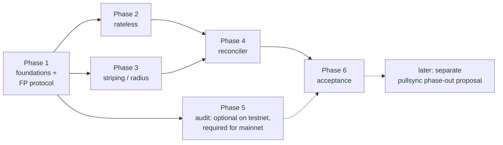

# Implementation plan: `rangesync` (rateless variant)

Source proposal: [`../pullsync-rangesync-rateless-proposal.md`](../pullsync-rangesync-rateless-proposal.md).
Section references like **§5.2** point into that file.

This folder splits the proposal into phases and tasks. Each task is sized so one
Claude Code session can pick it up cold, implement it with tests, and land it on its phase
branch. There are no PRs; see [EXECUTION.md](EXECUTION.md) for branches, order and gates.

## Ground rules: a new protocol, built in parallel

- `rangesync` is a **new, independent protocol in its own package tree** (`pkg/rangesync/...`).
- **`pkg/pullsync` and `pkg/puller` are not modified.** Not even to share helpers. If
  `rangesync` needs something that lives there (stream limiter, delivery validation),
  copy it into `pkg/rangesync` and say so in the commit message.
- Outside `pkg/rangesync`, only **additive** changes are allowed, and only where a task names
  them: `pkg/storer` (opt-in address index + observer hook), `pkg/node` + `cmd/bee`
  (wiring, flags, combined syncer), and optionally `pkg/storageincentives` (Phase 5 hook).
- Two independent switches (§8.3): `--puller-enable` (default `true`) and
  `--rangesync-enable` (default `false`). With the defaults, a node must behave exactly as
  today: no `rangesync` protocol registered, no `ChunkAddrItem` writes, no Index memory.
- Phasing out `pullsync` is **out of scope**. Phase 6 produces the acceptance results that
  a later, separate phase-out proposal will be based on.

## How to use this folder in a Claude session

The orchestrator (see [EXECUTION.md](EXECUTION.md) §4) gives each implementer subagent this
prompt, plus the gate decisions so far and the contracts the task consumes. It also works
pasted into a standalone session started in the bee repo root:

```
Implement task <ID> from proposal/rangesync-rateless-plan/<phase file>.
Read the task, the proposal sections it cites, the "Ground rules" in
proposal/rangesync-rateless-plan/README.md, and AGENTS.md first.
Work in the worktree ../bee-wt/<ID> on branch rangesync/<ID>-<slug>, cut
from rangesync/phase-<N>. Use TDD. Run the pre-commit checklist from
AGENTS.md for the packages you touched. Do not modify pkg/pullsync or
pkg/puller. Do not tick README.md (the orchestrator does when it lands the task).
Write any decision you had to make under "Decisions log" in the phase file
and anything out of scope under "Follow-ups". If a cited API, line or
behaviour differs from the task text, stop and report instead of
redesigning.
```

Rules every session follows:

- Read `AGENTS.md`, `CODING.md`, `CODINGSTYLE.md` before writing code.
- **No new `go.mod` dependencies.** `golang.org/x/crypto` (sha3/SHAKE128, keccak) and
  `github.com/btcsuite/btcd/btcec/v2` are already present. The Rateless IBLT is implemented
  in-tree (§5.4).
- **Fuzzing is deferred (since 2026-10-15).** Remaining tasks write no `*_fuzz_test.go` files and
  run neither `make fuzz` nor `make fuzz-regression`. For this plan that overrides the AGENTS.md
  fuzz rule. A task that adds a parser, decoder or validator of peer input instead appends one line
  to [followup-fuzzing.md](followup-fuzzing.md) (task TF). Fuzz targets that already exist stay;
  `go test` runs their seed corpus as ordinary tests.
- Only touch what the task names. Anything else goes under "Follow-ups" in the phase file.
- Constants live in `pkg/rangesync/constants.go` (protocol) and
  `pkg/rangesync/fingerprint/constants.go` (index); see the table below.
- Any task that touches `pkg/storer` or `pkg/node` must show that `go test ./pkg/pullsync/... ./pkg/puller/... ./pkg/storer/...`
  still passes, and that the defaults change nothing (see T1.13).

## Package layout (§11)

```
pkg/rangesync/                 protocol service: rangesync.go status.go session.go fetch.go
                               streamlimit.go constants.go metrics.go doc.go
pkg/rangesync/pb/              rangesync.proto + generated code
pkg/rangesync/fingerprint/     lthash.go fenwick.go rateless.go index.go constants.go
                               (no dependency on pkg/storer)
pkg/rangesync/wantset/         in-flight want set, rejected cache
pkg/rangesync/reconciler/      topology subscription, per-peer state, rounds, striping, SyncRate
pkg/rangesync/audit/           salted audit (Phase 5, optional)

pkg/storer/...                 additive: ChunkAddrItem (opt-in), ReserveAddrStore,
                               ReserveObserver, ChunkID, address-index option
pkg/node, cmd/bee              flags, wiring, combined syncer
```

Import direction: `rangesync/*` → `storer`, `p2p`, `topology`, `postage`, …;
`storer` → nothing in `rangesync`. `fingerprint` imports neither.

## Phases

| Phase | File | Ships | Depends on |
|---|---|---|---|
| 1 | [phase-1-index-and-fingerprint-protocol.md](phase-1-index-and-fingerprint-protocol.md) | Package skeleton, opt-in address index + observer in storer, `fingerprint.Index` (counts, LtHash), want set, protocol with fingerprints + item lists, minimal reconciler, flags, combined syncer | — |
| 2 | [phase-2-rateless-symbols.md](phase-2-rateless-symbols.md) | Rateless IBLT, symbol caches, `Symbols`/`More` parts | 1 |
| 3 | [phase-3-striped-bootstrap-and-radius.md](phase-3-striped-bootstrap-and-radius.md) | Striped bootstrap, radius-decrease handling, catch-up `SyncRate` | 1 |
| 4 | [phase-4-reconciler-rounds.md](phase-4-reconciler-rounds.md) | Full reconciler: status gossip, state machine, rounds, rejected cache | 2, 3 |
| 5 | [phase-5-audit-in-storageincentives.md](phase-5-audit-in-storageincentives.md) | **Optional for testnet, required before mainnet.** Salted audit with an optional storageincentives hook | 1 (T5.2 also T4.1; T5.3 also Phase 2) |
| 6 | [phase-6-acceptance-testing.md](phase-6-acceptance-testing.md) | Acceptance tests, testnet comparison, toggle safety, exit report | 4 (5 if done) |



## Parallelism map (what can run in separate sessions at the same time)

Each task's own **Depends on** line is authoritative; this table is derived from them.
Execution is serial now (one subagent at a time); [EXECUTION.md](EXECUTION.md) §5 holds the
order actually followed.

| Wave | Parallel tasks (dependencies) |
|---|---|
| 0 | T1.0 (snapshot/lock spike) · T1.1 (skeleton, types, proto, constants) |
| A | T1.2 LtHash (T1.1) · T1.3 Fenwick (T1.1) · T1.7 want set (T1.1) · T1.8 session logic (T1.1) · T2.0 CertainSync spike · T6.0 acceptance criteria draft |
| B | T1.4 storer `ChunkAddrItem` + observer (T1.0) · T1.6 Index (T1.0, T1.2, T1.3) · T2.1 rateless library (T2.0) |
| C | T1.5 storer fill/iteration/API (T1.4) · T2.2 symbol caches (T1.6, T2.1) · T2.7 integer mapper, optional (T2.1) |
| D | T1.9 status/reconcile (T1.5, T1.6, T1.8) · T1.10 fetch (T1.5, T1.7) · T2.3 symbols API (T2.2, T1.5) |
| E | T1.11 minimal reconciler (T1.9, T1.10) · T2.4 symbol session (T2.3, T1.8, T1.9) · T3.1 stripe planner (T1.8, T1.9) |
| F | T1.12 node wiring (T1.11) · T2.5 (T2.4) · T2.6 (T2.4) · T3.2 striped transfer (T3.1, T1.9, T1.10) · T4.1 status gossip (T1.9, T1.11) |
| G | T1.13 integration tests (T1.12) · T3.3 verification (T3.2) · T3.4 radius changes (T3.2, T1.6) · T4.2 state machine (T1.11, T3.2) · T5.1 audit (T1.2, T1.5, T1.12) |
| H | T3.5 catch-up `SyncRate` (T3.2, T3.4, T1.11, T1.12) · T4.3 scheduler (T4.1, T4.2, T2.4) · T5.2 audit in `Status` (T5.1, T4.1) |
| I | T4.4 want set in rounds (T4.3, T1.7) · T5.3 salted sessions (T5.2, Phase 2) |
| J | T4.5 replace minimal reconciler (T4.2–T4.4, T3.5) |
| K | T4.6 simulation (T4.5) |
| L | T6.1 · T6.2 · T6.3, then T6.4 (Phase 4; Phase 5 if done). T6.2 may start as early as wave G (needs only T1.12) and is rerun here |

## Progress

Tick a box when the task lands on its phase branch. The orchestrator ticks it when landing, not
the implementer (otherwise every task conflicts on this list).

**Phase 1**
- [x] T1.0 Spike: snapshot isolation and lock ordering (blocks T1.4, T1.6)
- [x] T1.1 Package skeleton, protobuf, constants
- [x] T1.2 LtHash16 primitive (+ ECMH benchmark)
- [x] T1.3 Fenwick tree
- [x] T1.4 Storer: opt-in `ChunkAddrItem`, write/delete paths, `ReserveObserver` hook
- [x] T1.5 Storer: fill/marker toggle logic, address iteration, `GetByID`, public API, mock
- [x] T1.6 `fingerprint.Index` (counts + LtHash, Apply, Summary, Rebuild) + observer adapter
- [x] T1.7 Want set (`pkg/rangesync/wantset`)
- [x] T1.8 Pure session decision logic (fingerprints + items) and session-root relation
- [x] T1.9 `status` and `reconcile` stream handlers + validation
- [x] T1.10 `fetch` stream + delivery validation
- [x] T1.11 Minimal reconciler (topology subscription, timer-driven sessions, `SyncRate`)
- [x] T1.12 Node wiring: flags, combined syncer, metrics registration
- [x] T1.13 Integration, coexistence and adversarial tests, metrics

**Phase 2**
- [x] T2.0 Spike: CertainSync vs Rateless IBLT (open question 4)
- [x] T2.1 `fingerprint/rateless.go`: mapping, checksum, encoder, peeling decoder, wire codec
- [x] T2.2 Symbol caches in the Index (bucket Fenwick, level-1, root, scan path)
- [x] T2.3 Index `Symbols` API + scan path over `ReserveIterateAddr`
- [x] T2.4 Session: `Symbols` / `More` parts, capacity, estimate, exhaustion, corruption fallback
- [x] T2.5 Symbol-stream limits (budget, scans per message, `More` validation)
- [x] T2.6 Benchmarks (`BucketSymbols` 16 vs 32), worked-example tests, symbol metrics
- [ ] T2.7 (optional, before mainnet) Integer `Mapper`
- [ ] T2.8 (deferred, before mainnet) Cross-architecture determinism vectors

**Phase 3**
- [x] T3.1 Bootstrap detection and stripe planner
- [x] T3.2 Striped transfer with pipelined paging/fetch and reassignment
- [x] T3.3 Verification round
- [x] T3.4 Radius decrease / increase handling
- [x] T3.5 Catch-up `SyncRate` and reserve-worker interplay

**Phase 4**
- [x] T4.1 Status gossip (debounce + heartbeat)
- [x] T4.2 Per-peer state machine (probing, unsupported peers)
- [x] T4.3 Round scheduler (initiator rule, adaptive interval, session caps)
- [x] T4.4 Want-set integration in rounds + rejected cache
- [x] T4.5 Replace the minimal reconciler; dual-mode coexistence
- [x] T4.6 Neighborhood simulation / N-node integration test
- [x] T4.7 Hardening: G6 constants + pre-testnet blockers (added at G6)

**Phase 5 (optional for testnet, required before mainnet)**
- [ ] T5.1 Audit computation + optional round hook in storageincentives
- [ ] T5.2 `AuditRound`/`AuditDigest` in `Status` + mismatch handling
- [ ] T5.3 Salted session mode (collision-suspected path)

**Phase 6**
- [x] T6.0 Draft acceptance criteria (wave A)
- [x] T6.1 Mixed-network acceptance test suite
- [x] T6.2 Toggle-safety and upgrade/downgrade tests
- [ ] T6.3 Testnet runbook, dashboards, comparison runs
- [ ] T6.4 Acceptance criteria + exit report (input for the phase-out proposal)
- [ ] T6.5 Pre-cluster fixes and observability (added 2026-10-26; before T6.3's cluster runs)

**Follow-up (deferred)**
- [ ] TF Fuzz targets for every `rangesync` peer-input decoder added since 2026-10-15 ([followup-fuzzing.md](followup-fuzzing.md))

## Shared constants (§6.3, §8.2, §8.4)

| Constant | Value | Owner task |
|---|---|---|
| `LeafBits` (fingerprint) | 12 | T1.1 defines, T1.6 uses |
| `FanoutBits` (fingerprint) | 4 | T1.1 defines, T1.8 uses |
| `RootSymbols` / `Level1Symbols` / `BucketSymbols` (fingerprint) | 4096 / 512 / 32 | T1.1 defines, T2.2 uses |
| `ScanLimit` (fingerprint) | 4096 | T1.1 defines, T2.2 uses |
| `MinBatch`, batch factor, growth factor | 4, 1.6, 2 (growth 4 → 2 at G6) | T2.4, T4.7 part 2 |
| `MaxParts`, `MaxMessageBytes` | 1024, 1 MiB | T1.1 |
| `ItemsPageSize` | 1024 | T1.8 |
| `LargeDiff` | 65536 | T1.8 (hook), T3.1 (use) |
| `SessionSymbolBudget`, `MaxScansPerMessage` | 16384, 64 | T2.5 |
| `MaxConcurrentSessions` (node / per peer) | 16 / 1 | T1.9 |
| Initiated-session cap (per node) / `MaxStripeSessions` | `InitiatedSessionCap(H, L)` = max(8, min(H + 4, 16 − L − max(0, H + L − 16))), 8–16; stripe slots 4 | T4.3, T4.7 part 2 |
| `StatusMinInterval` / `StatusMaxInterval` | 5 s / 60 s | T4.1 |
| `RoundInterval` | adaptive 5–30 s | T4.3 |
| Claim deadline / `RejectTTL` | 30 s / 10 min | T1.7 / T4.4 |
| Want-set caps `wantset.MaxClaims` / `wantset.MaxClaimsPerPeer` (node / per peer) | 10000 / 1000 | T1.7 |
| Fetch limit (global) | 1000 chunks/s | T1.10 |
| `CatchUpMinDiff` | 256 | T1.11, T3.5 |
| `SyncRate` window | 10 min (same as `puller.DefaultHistRateWindow`) | T1.11 |
| `DefaultMapperID` (fingerprint) | 1 (`FloatMapper`); 2 reserved for `IntegerMapper` | T1.1 defines, T2.1, T2.7 |
| Start-up `SyncRate` guard timeout | 2 × `StatusMaxInterval` = 120 s | T1.11 |
| Fill-blocking threshold | 60 s on a full reserve | T1.5 |

## Open questions (§14) and where they get answered

| # | Question | Resolved in |
|---|---|---|
| 1 | LtHash16 vs ECMH | T1.2 benchmark |
| 2 | Cache sizes 4096/512/32 | T2.6 + `pairwise_diff` from T1.13 / T4.6 |
| 3 | Request-driven vs streamed batches | T2.6, revisit after T4.6 |
| 4 | CertainSync | T2.0, which **blocks** T2.1 |
| 5 | `StorageRadius` vs `CommittedDepth` for the root | **Resolved:** root = `StorageRadius()` (what `IsWithinStorageRadius` uses); `CommittedDepth()` = radius + capacity doubling, used only by the audit |
| 6 | Snapshot semantics of the IndexStore iterator | T1.0 spike, which **blocks** T1.4 and T1.6 |
| 7 | Expired-batch skew | T4.4 |
| 8 | Round trigger on failed pushsync | T4.3 (optional hook, default off) |
| 9 | `CatchUpMinDiff` | T3.5, confirmed in T6.3 |
| 10 | Acceptance criteria for the phase-out | drafted in T6.0 (wave A), finalised in T6.4 |

## Issues resolved by the "parallel, new package" approach

These came up when mapping the proposal onto the code; the amended proposal and the tasks
already reflect the resolution.

1. **No changes to `pullsync`.** The old Phase 0 (a node-wide want set inside
   `pullsync.Sync`) is dropped, and so is its interval-hole hazard
   (`puller.syncPeerBin` records intervals even on error). The want set exists only inside
   `rangesync` (T1.7). Duplicates **between** the two protocols in dual mode are accepted and
   measured (`cross_protocol_duplicates_total`); `rangesync` re-checks `ReserveHasID` right
   before each `Want` to keep them low.
2. **No changes to `puller`.** The old "skip historical/live workers and epochs for v2 peers"
   tasks are gone. `rangesync` has its own reconciler with its own topology subscription
   (`kademlia.SubscribeTopologyChange` supports multiple subscribers). Edge-peer eligibility
   uses the session-root rule (§7.6); `maxPODelta` stays as it is in the puller.
3. **`SyncRate()` coupling (§8.4).** The puller's `SyncRate()` gates radius decreases
   (`pkg/storer/reserve.go`, `reserveWorker`), node status (`nodeStatus.SetSync`) and
   redistribution's "fully synced" check and warm-up (`pkg/node/node.go`).
   `storer.StartReserveWorker` takes exactly one `storer.Syncer` (it's a `sync.Once`).
   Resolution: the reconciler implements `storer.Syncer`, reporting **catch-up** fetch rate
   only, and the node passes a combined syncer that sums the enabled drivers (T1.11, T1.12,
   T3.5). Without this, a `rangesync`-only node would never lower its radius and never count
   as synced for redistribution.
4. **Zero cost when disabled.** `ChunkAddrItem` is opt-in, not a numbered migration
   (numbered steps run on every node). A validity marker makes toggling safe: enabling with
   no marker drops and refills the namespace (blocking or in the background, D5); disabling
   deletes the marker and drops the namespace in the background (D10) (T1.4, T1.5). The
   `db repair` tool drops both. `rangesync` and the address index exist only on full nodes (D15).
5. **Fingerprint code is not under `storer/internal`.** It lives in
   `pkg/rangesync/fingerprint` and has no storer dependency; the storer only offers
   iteration and a `ReserveObserver` hook. This removes the visibility problem of
   `internal/` and keeps the storer free of fingerprint logic.
6. **Separate rate limits.** `rangesync` has its own fetch and delivery limiters. In dual mode
   the node's total pull budget is the sum of both (documented in §8.2).
7. **Audit is additive.** Phase 5 adds an optional, nil-by-default round hook to the
   storageincentives agent; nothing changes when `rangesync` is off. It is optional for testnet
   and required before mainnet (D11).
8. **Full protobuf defined in Phase 1** (including `Symbols`/`More`, `Status.Mapping` and
   `Message.AuditRound`), so the wire schema is reviewed once and Phases 2 and 5 need no version
   bump. Phase-1 handlers reject `Symbols`/`More` and ignore a non-zero `AuditRound`. If T2.0/T2.1
   change the `Symbols` encoding, bump the protocol version before Phase 2 ships (flag-gated, so no
   compatibility promise exists yet).

## Decisions made before implementation

| # | Topic | Decision | Where |
|---|---|---|---|
| D1 | CertainSync vs Rateless IBLT | T2.0 runs first and blocks T2.1 | phase 2 |
| D2 | Symbol mapping determinism | Start with a `float64` `FloatMapper` behind an injectable `Mapper` interface (indices + expected counts). The mapper ID travels in `Status.Mapping`; peers with different IDs don't run sessions. An `IntegerMapper` (T2.7) can replace it later; changing the default is a network-wide switch. No compatibility promise with the reference `riblt` library. | §4.3.4, §5.2, §6.2; T2.1, T2.7 |
| D3 | Snapshot isolation + lock ordering | T1.0 spike blocks the storer observer (T1.4) and the Index rebuild (T1.6). Rule: never hold the Index write lock while calling into the reserve. | §5.2; T1.0 |
| D4 | Protocol-violation penalty | Reset the stream and disconnect (as `pullsync` does) + raise the reconciler's failure score. No blocklisting for now. | §6.4; T1.9 |
| D5 | Address-index fill when enabling | Blocking fill if < 60 s on a full reserve, else background fill under the per-batch lock with revalidation, `Busy` until ready. T1.5 measures and picks. | §5.1; T1.5 |
| D6 | Flag naming | `--puller-enable` (it only stops the puller; `pullsync` handlers stay registered) and `--rangesync-enable` | §8.3; T1.12 |
| D7 | Acceptance criteria | Drafted now (T6.0) so Phases 1–4 emit the right metrics | T6.0 |
| D8 | Root radius (Q5) | `StorageRadius()`; fetched IDs are filtered with `IsWithinStorageRadius` | §14 Q5; T1.6, T1.10 |
| D9 | Start-up `SyncRate` | Non-zero sentinel until the first status exchange with all eligible neighbors, so the radius can't drop on an empty reserve | §8.4; T1.11 |
| D10 | Disk cleanup | Disabling `rangesync` drops the `chunkAddr` namespace in the background | §5.1; T1.5 |
| D11 | Audit and mainnet | Phase 5 is optional for testnet, required before any mainnet node enables `rangesync` | §12; phase 5 |
| D12 | Testnet cohorts | `rangesync`-only cohorts cover whole neighborhoods; dual cohorts may lower `rangesync`'s fetch limit | T6.3 |
| D13 | Exact deltas | `−id`/`+id` only for `ChunkAddrItem`s actually deleted/written in that transaction; the observer drops deltas until the address index is ready | §5.4; T1.4, T1.6 |
| D14 | Async rebuild | `RadiusChanged` only queues a rebuild (one coalescing goroutine); observer registered before the first rebuild | §5.2; T1.6 |
| D15 | Full nodes only | `rangesync` and the address index only when `FullNodeMode && !BootnodeMode`; the flag is ignored with a warning otherwise | §8.3; T1.12 |
| D16 | Id-only existence check | `ReserveHasID(addr, stampHash)` (peers don't send the batch ID); `ReserveAddrIndexReady()` exposed in both fill variants | §5.4; T1.5, T1.10 |
| D17 | One failure score | The reconciler owns it (T1.11) behind `PeerScorer`; T1.9, T3.3 and T4.4 report into it | T1.9, T1.11, T3.3, T4.4 |
| D18 | Guard timeout | The start-up `SyncRate` sentinel lifts after 120 s at the latest; the value keeps the `PullsyncRate` field name | §8.4; T1.11, T1.12 |
| D19 | Reserved wire fields | `Status.Mapping` and `Message.AuditRound` in the Phase-1 proto; `AuditRound` = the round the anchor belongs to (*t + 1*) | §6.2, §7.9; T1.1, T5.1, T5.3 |
| D20 | Generic Fenwick | T1.3 is type-agnostic; the LtHash and symbol adapters live in T1.6 and T2.2 | T1.3, T1.6, T2.2 |
| D21 | Mapper selection | `rangesync.Options.Mapper` (default `FloatMapper`); no node flag until a rollout is planned | T2.7 |
| D22 | Cross-arch vectors | Deferred: T2.1 commits amd64 vectors only; the arm64 run is T2.8, before mainnet. Until then testnet cohorts run on one architecture | T2.1, T2.8, T6.3 |
